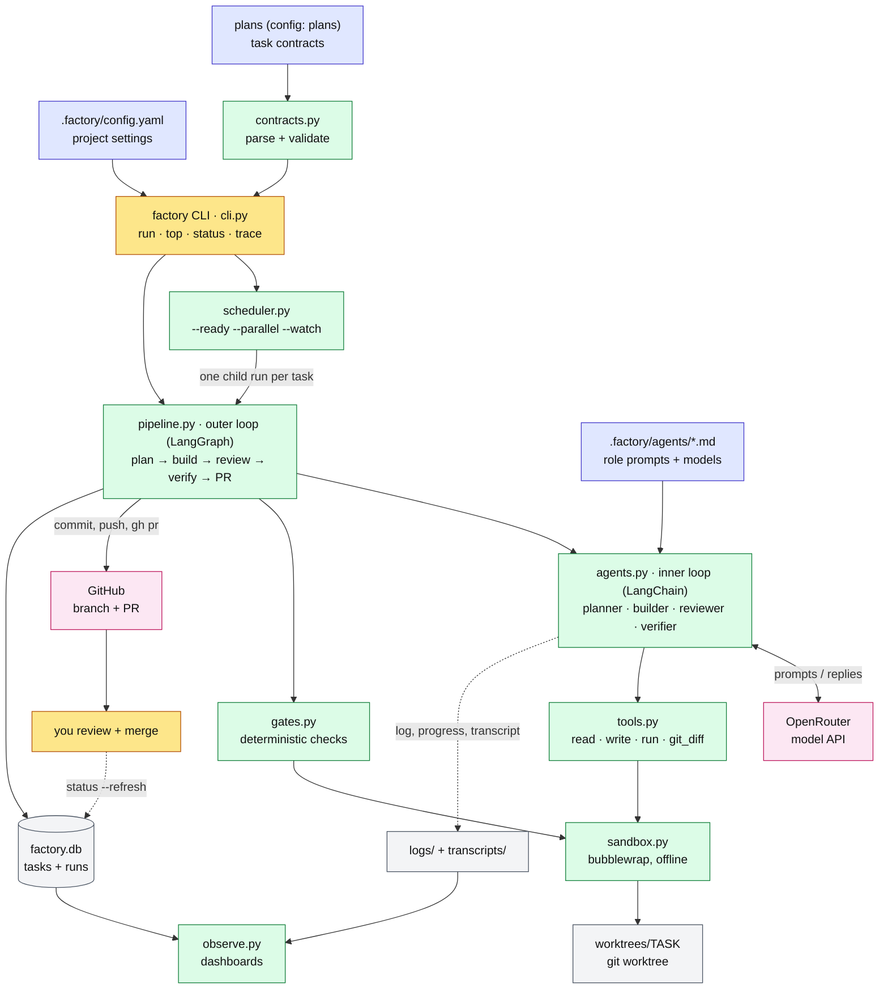
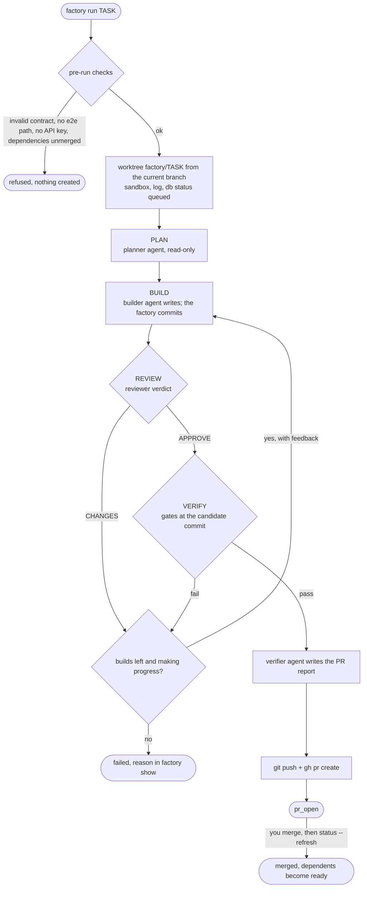
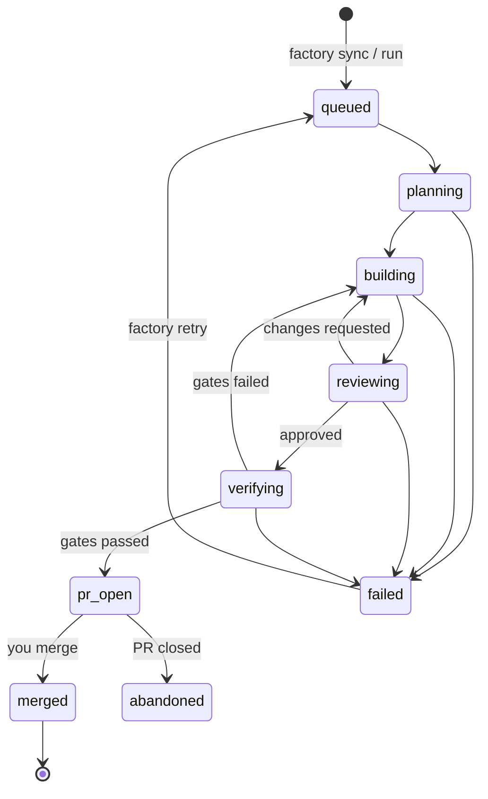
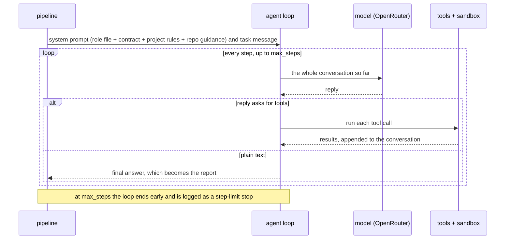

# Software factory

`factory run <task>` takes one **task contract** from your repository's plans to a **working pull request**. Four AI agents, a planner, a builder, a reviewer and a verifier, work in an isolated, sandboxed git worktree. A PR is opened only when every deterministic check passes at the exact candidate commit. A human merging the PR is the approval.

The factory is project-agnostic. Everything specific to a repository lives in that repository:
- `.factory/config.yaml`: where plans are, which tests every task must add, what runs as unit and e2e gates, and what the sandbox mounts;
- `.factory/agents/*.md`: the role prompts and their models.

`factory init` scaffolds both, and installs two workflow skills for Claude Code / OpenCode: `/plan-workstream`, which writes plans with task contracts, and `/review-task`, which reviews a task's PR.

---

## Quick start

```bash
# prerequisites: uv, bubblewrap (bwrap), git, gh (authenticated), your project's toolchain
uv tool install /path/to/software-factory        # or: alias factory='uv run --project /path/to/software-factory factory'

cd your-repo
factory init                      # .factory/config.yaml, .factory/agents/*.md, .claude/skills/{plan-workstream,review-task}
$EDITOR .factory/config.yaml      # plans location, e2e/session-log requirements, unit tests, sandbox
factory config                    # the effective settings

# write task contracts (see below; /plan-workstream in Claude Code does it with you), then:
factory validate-plan
export OPENROUTER_API_KEY=sk-or-...
factory sync                      # load every task contract into the local db
factory status                    # the board: ready / waiting / running / PR open / failed
factory run <task-id>             # one task, foreground
factory run --ready --parallel 3 --watch   # every ready task; dependents start as PRs merge
factory top                       # live dashboard (another terminal)
```

The agents' sandbox is offline, so fetch dependencies first (`cargo fetch`, `uv sync`, `npm ci`, …).

---

## Architecture



Colours:
- **yellow:** you;
- **blue:** your repository's inputs;
- **green:** factory code;
- **grey:** local state (`$FACTORY_HOME`);
- **pink:** external services.

Dotted lines are observability data, not control flow.

| Layer | Module | Responsibility |
|---|---|---|
| Entry | `cli.py` | Commands, pre-run checks (contract valid, e2e path writable, API keys present, dependencies merged), worktree setup, `init` and `config` |
| Settings | `config.py` | Load and validate `.factory/config.yaml` from the **main checkout** (never a task worktree, so an agent can't weaken its own gates) |
| Contracts | `contracts.py` | Read the fenced YAML in plans into `Task` objects (9 keys). Validate schema, IDs, dependencies across plans, path bounds, command selection, placeholders |
| Scheduling | `scheduler.py` | Start ready tasks as child `factory run` processes, up to `--parallel`. Poll merges with `--watch`. Enforce `--budget` |
| Outer loop | `pipeline.py` | LangGraph state machine: plan → build → review → verify → PR / fail. Commits the builder's work. Stops early when there is no progress |
| Inner loop | `agents.py` | One LangChain `create_agent` per role: loads the role file, builds the system prompt (role + contract + project rules + repository guidance), streams steps, counts tokens and cost, records the transcript |
| Tools | `tools.py` | `read_file`, `list_dir`, `grep`, `git_diff`, `write_file`/`edit_file` (only inside `allowed_paths`), `run` (sandboxed; denied commands refused) |
| Checks | `gates.py`, `verification.py` | Scope, plan untouched, and the configured session-log, e2e, unit and verification checks. Zero tests selected counts as failed |
| Isolation | `sandbox.py` | bubblewrap: read-only host, empty `$HOME`/`/tmp`/`/run`, cleared environment, no network unless asked |
| State | `db.py` | SQLite `tasks` (status, branch, SHAs, PR, pid, heartbeat, activity, cost) and `runs` (every role step: outcome, report, steps, tokens, cost, refused calls, transcript path) |
| Observability | `observe.py`, `log.py`, `prices.py` | Dashboard, merged logs, traces, transcripts, liveness, OpenRouter cost |

---

## Lifecycle of one task





What moves between agents is only what the pipeline hands over:

| From | To | What |
|---|---|---|
| Planner | Builder | The plan text |
| Reviewer (`VERDICT: CHANGES`) | Builder | The review, as feedback to address first |
| Gates (fail) | Builder | The failing gates' output, as feedback |
| Gates (pass) | Verifier | The gate table, for the PR report |

A build is retried up to `--max-attempts` times (default 3). The run stops earlier when the same gates fail with identical output twice in a row. A task that ends `failed` stays failed: nothing reruns it automatically. `factory retry` puts failed tasks back to `queued`, and a scheduler then starts them again, including one already running with `--watch`.

---

## Inside one agent: the loop



- **Context grows every step.** Each step re-sends the entire conversation. In practice 95–98% of tokens are re-read input, and output is small. `factory trace` shows the growth step by step.
- **Step limits.** Each step is 4 LangGraph nodes (call-limit hook, model, call-limit hook, tools). `ModelCallLimitMiddleware` enforces `max_steps`; the graph recursion limit (`4 × max_steps + 25`) is only a backstop.
- **Recoverable errors.** These come back to the model as results so the agent can adjust:
  - a write outside the allowed paths, or a denied command, returns `refused: …`;
  - a failing tool call returns `error: …`.

  Both are flagged with ⚠ in the log.
- **Provider errors.** Rate limits, out-of-credit and network blips are retried with backoff (about 30 s). After that the run fails with the provider's real error.

### Roles

| Role | Default model (OpenRouter) | `max_steps` | Tools | Decides |
|---|---|---|---|---|
| planner | `z-ai/glm-5.3` | 40 | read | The implementation plan |
| builder | `deepseek/deepseek-v4-pro-0813` | 120 | read, write in `allowed_paths` (plus the session log and `always_allowed`), sandboxed `run` | The change |
| reviewer | `z-ai/glm-5.3` | 60 | read, `git_diff` | `VERDICT: APPROVE` or `CHANGES` (missing verdict = CHANGES) |
| verifier | `deepseek/deepseek-v4-flash-0731` | 30 | read, `git_diff`, sandboxed `run` | Nothing: it writes the PR report; **the gates decide** |

Change models and step limits in the frontmatter of `.factory/agents/<role>.md`; `--model` overrides every role for one run. Any `provider:model` that LangChain's `init_chat_model` supports works, with the provider's key in the environment (`OPENROUTER_API_KEY`, `ANTHROPIC_API_KEY`, `OPENAI_API_KEY`).

The system prompt is assembled from four parts:
1. the role file;
2. the contract;
3. a **Project rules** block generated from `.factory/config.yaml`, telling the agent what the gates will require (session log, e2e test, unit commands);
4. the repository's own guidance files (`guidance`, default `CLAUDE.md` and `AGENTS.md`).

The shipped role prompts therefore carry no project specifics.

No agent can commit, push, call `gh`, run `factory`, or touch the database. The pipeline does those things outside the sandbox.

---

## Configure a project

`.factory/config.yaml`. Every key is optional; `factory config` prints the effective values.

| Key | Default | Meaning |
|---|---|---|
| `name` | repo directory name | Names the state directory `~/.local/share/factory/<name>` |
| `home` | — | State directory override (`$FACTORY_HOME` wins over both) |
| `plans` | `["docs/plans/**/*.md"]` | Markdown files holding task contracts |
| `exclude` | `[]` | Globs never read as backlog (e.g. `docs/ideas/**`) |
| `guidance` | `["CLAUDE.md", "AGENTS.md"]` | Repository guidance appended to every agent's prompt, if present |
| `session_log` | — | Directory: every task must add `<dir>/<today>.md` (`session_log` gate) |
| `e2e.dir` | — | Every task must add a new test directly under this directory (`e2e_written` gate) |
| `e2e.language` | `rust` | How new tests are found: `rust` (`#[test]`, `#[tokio::test]` fns) or `python` (`def test_*`) |
| `e2e.run_new` | — | Command run per new test; `{target}` = file stem, `{name}` = function, `{path}` = repo-relative file |
| `e2e.run_all` | — | The whole suite (used with `--full-e2e`, or when `run_all_when` matches) |
| `e2e.run_all_when` | `[]` | Regexes over changed paths that run the whole suite instead of only the new tests |
| `unit_tests` | `[]` | Commands for the `unit_tests` gate |
| `always_allowed` | `[]` | Globs every task may write besides its `allowed_paths` |
| `warn_only` | common lockfiles | Files that may change outside `allowed_paths` with only a warning |
| `denied_commands` | `[]` | Extra regexes the agents' `run` tool refuses (git push/commit/reset…, `sudo`, `gh`, `terraform apply/destroy` and `factory` are built in) |
| `sandbox.ro_binds` / `rw_binds` | rustup + uv read-only, `~/.cargo` writable | Host paths visible inside the sandbox (missing ones are skipped) |
| `sandbox.hide` | cargo credentials | Files masked with `/dev/null` |
| `sandbox.path` | `~/.cargo/bin`, `~/.local/bin` | Prepended to `PATH` |
| `sandbox.env` / `offline_env` | cargo/uv cache dirs / `CARGO_NET_OFFLINE`, `UV_OFFLINE` | Environment (`~` = home, `{cache}` = `$FACTORY_HOME/cache`); `offline_env` applies without `--network` |
| `sandbox.cache_dirs` | `target`, `uv` | Subdirectories of the shared cache to create |

**A Rust workspace** with a dedicated e2e crate (`my-e2e`); changes to the core crates run the whole e2e suite:

```yaml
name: my-chain
exclude: ["docs/ideas/**"]
session_log: docs/sessions
e2e:
  dir: crates/e2e/tests/
  language: rust
  run_new: "cargo test -p my-e2e --test {target} {name} -- --exact"
  run_all: "cargo test -p my-e2e"
  run_all_when: ['^crates/(core|consensus|node)/']
unit_tests: ["cargo test --workspace --exclude my-e2e"]
```

**A Python project:**

```yaml
name: shop
plans: ["planning/**/*.md"]
e2e:
  dir: tests/e2e/
  language: python
  run_new: "uv run pytest {path}::{name}"
  run_all: "uv run pytest tests/e2e"
unit_tests: ["uv run pytest -q tests/unit"]
sandbox:
  ro_binds: ["~/.local/bin", "~/.local/share/uv"]
  rw_binds: []
  env: {UV_CACHE_DIR: "{cache}/uv"}
  offline_env: {UV_OFFLINE: "1"}
```

---

## Task contracts

A plan carries a fenced `yaml` list. Each item has **exactly** these 9 keys; status lives in the database, never in the plan:

```yaml
- id: my-workstream-t01               # workstream-prefixed, unique across plans
  goal: "One observable deliverable"
  spec_refs: ["docs/spec/api.md#orders"]
  depends_on: []                      # task ids, may be in other plans; runs only after these merge
  allowed_paths:                      # the only paths the builder may write
    - src/orders/**
    - tests/e2e/test_orders.py        # if e2e.dir is configured: somewhere a new e2e test can go
  non_goals: ["What not to do"]
  acceptance: ["Observable condition proving it is done"]
  verification: ["uv run pytest tests/e2e/test_orders.py::test_refund_flow"]
  risk: low                           # low | medium | high
```

`factory validate-plan` checks:
- schema;
- dependencies, including across plans and for cycles;
- path bounds;
- command selection;
- placeholders.

It also warns about contracts that can't hold a new e2e test when the project requires one, and `factory run` refuses those. Plans without a task block are not executable. `/plan-workstream` writes plans in this shape (see [Skills](#skills)).

---

## Gates

They run in the sandbox against the exact candidate commit, in this order. Gates marked *configured* exist only when the project sets them up:

| Gate | Passes when |
|---|---|
| `clean` | Worktree HEAD is the candidate and the worktree has no uncommitted changes |
| `diff` | The candidate changes something |
| `scope` | Every changed file is in `allowed_paths`, the session log, or `always_allowed`. `warn_only` files only warn |
| `plan_untouched` | The task's plan doc was not edited |
| `session_log` *(configured)* | A `<session_log>/*.md` entry was added |
| `e2e_written` *(configured)* | A new test was added under `e2e.dir` |
| `verification` | Every command in the contract's `verification` passes |
| `unit_tests` *(configured)* | Every `unit_tests` command passes |
| `e2e_tests` *(configured)* | The new e2e tests pass by name (`run_new`), or the whole suite (`run_all`) with `--full-e2e` or when `run_all_when` matches |

A command that selects zero tests is **inconclusive, not a pass**. `factory gates <task> --ref <ref>` runs the same gates without agents, for reviewing hand-written work; `/review-task` builds on it.

---

## Skills

`factory init` installs two agent skills into `.claude/skills/`. Claude Code loads them there, and OpenCode reads the same directory. Both are explicit-invocation only, and both read the project's `.factory/config.yaml`, so they carry no project specifics.

| Skill | Use | What it does |
|---|---|---|
| [`/plan-workstream`](factory/templates/skills/plan-workstream/SKILL.md) | Before work starts | Grounds in the config, roadmap, plans and code; locks 2–4 strategic decisions with you; writes a plan whose contracts satisfy the configured gates; updates the roadmap; runs `factory validate-plan` |
| [`/review-task TASK [REF]`](factory/templates/skills/review-task/SKILL.md) | Before you merge | Runs `factory gates` (cheap, then full) on the task's branch, applies the reviewer checklist from `.factory/agents/reviewer.md`, and reports APPROVE or REQUEST CHANGES. It never edits or merges |

The factory's own agents (planner, builder, reviewer, verifier) are role prompts, not skills. `factory init` writes them to `.factory/agents/` from [`factory/templates/agents/`](factory/templates/agents/).

Use `factory init --no-skills` to skip the skills. Existing files are kept unless you pass `--force`.

---

## Sandbox

Agent `run` calls and gate commands execute under bubblewrap (`sandbox.py`):

- The host filesystem is read-only.
- `$HOME`, `/tmp` and `/run` are empty, so ssh keys, gh and cloud tokens, and the docker socket are invisible. Only the configured `sandbox` binds reappear.
- The environment is cleared, then set from `sandbox.env`.
- Writable: the task worktree, `$FACTORY_HOME/cache` and the `rw_binds`.
- **No network** unless `--network` is passed (or `--network-for` in the scheduler), so dependencies must already be cached.

`--no-sandbox` exists for machines without bubblewrap and is unsafe.

---

## Commands

| Command | Purpose |
|---|---|
| `factory init [--force] [--no-skills]` | Scaffold `.factory/config.yaml`, the four role prompts and the two skills |
| `factory config` | Print the effective project settings |
| `factory validate-plan [PLAN…]` | Check contracts |
| `factory sync` | Load every contract from the plans into the db (statuses kept) |
| `factory status [--refresh] [--json]` | The board. `--refresh` picks up merged or closed PRs and fails dead runs |
| `factory run TASK [flags]` | Run one task in the foreground |
| `factory run --ready \| T1 T2 … --parallel N [--watch] [--budget USD]` | Scheduler: many tasks, each as its own child process. Only `queued` tasks start; live runs it did not start count toward `--parallel` |
| `factory top [--once]` | Live dashboard: progress, current action, elapsed and quiet time, cost, recent events |
| `factory logs TASK [-f] [-n N]` / `factory logs --all -f` | One task's log, or every task's log merged |
| `factory trace TASK [--role R] [--attempt N] [--all]` | Per-step model time, tool time, context size, cached tokens, output, cost, calls, largest results |
| `factory transcript TASK [--role R] [--attempt N] [--all] [--full]` | Exactly what the model saw and did |
| `factory show TASK [--role R]` | Every step's report and stats |
| `factory gates TASK [--ref R] [--base B] [--skip …]` | Deterministic gates only, in a throwaway worktree |
| `factory retry [TASK…]` | Requeue every failed (or dead) task, or the ones named: removes the leftover worktree and sets `queued` |
| `factory clean TASK` | Remove a task's worktree |
| `factory abandon TASK` | Mark a task abandoned (also a way to hold a task back from `--ready`) |
| `factory check-output --cmd C --exit N LOG` | Classify a test log (for CI) |

Useful `run` flags:

| Flag | Effect |
|---|---|
| `--base B` | Branch for the worktree and PR (default: current branch) |
| `--model M` | Override every role's model |
| `--max-attempts N` | Build attempts (default 3) |
| `--max-cost USD` | Abort the task above this cost |
| `--network` | Allow network in the sandbox |
| `--no-pr` | Stop after the gates pass, without pushing |
| `--skip-gates a,b` | Skip the named gates |
| `--full-e2e` | Always run the whole e2e suite |
| `--notify` | Desktop notification when the run ends |
| `--quiet` | Log to the file only |
| `--force` | Run even if the status or unmerged dependencies would refuse |

---

## Where things live

| Path | Contents |
|---|---|
| `$FACTORY_HOME/factory.db` | All task state (migrates older schemas in place) |
| `$FACTORY_HOME/worktrees/TASK/` | The task's git worktree on branch `factory/TASK` |
| `$FACTORY_HOME/logs/TASK.log` | Stage changes, agent messages, tool calls, gate results |
| `$FACTORY_HOME/transcripts/TASK/NNNNN-ROLE-ATTEMPT.jsonl` | Full transcript per role step (system prompt, messages, tool calls and results, usage, cost) |
| `$FACTORY_HOME/cache/` | Shared build caches, OpenRouter price list (refreshed daily) |

`FACTORY_HOME` defaults to `~/.local/share/factory/<name>` (or the config's `home`). Set it to keep a separate board, for example for experiments.

---

## Troubleshooting

| Symptom | Cause, and what to do |
|---|---|
| `cannot pass the e2e_written gate` | The project requires an e2e test, and none of the contract's `allowed_paths` is under `e2e.dir`. Fix the contract, or do the task by hand |
| `.factory/config.yaml: unknown key …` | A typo in the config; `factory config` shows what was understood |
| `worktree … exists from a previous run` | `factory retry TASK` (or `factory clean TASK`), then run again |
| Status `DEAD` | The `factory run` process died (killed, crashed). `factory status --refresh` marks it failed; `factory retry` requeues it |
| `⚠ stopped: step limit` in the log | The agent used `max_steps`. Raise it in `.factory/agents/ROLE.md`, or narrow the task |
| Gates fail on network or dependency fetches | The sandbox is offline. Fetch dependencies first, or pass `--network` for tasks that download |
| A tool is "not found" inside the sandbox | It lives under `$HOME`, which is hidden. Add its directory to `sandbox.ro_binds` and `sandbox.path` |
| `set OPENROUTER_API_KEY first` | Export the key for the providers named in the role files |
| `error: PaymentRequiredResponseError: … available credits` | OpenRouter credits ran out. Parallel runs reserve credit for their in-flight requests, so this can appear before the balance hits zero. Add credits, then `factory retry` |
| `error: … ConnectError` / `name resolution` | Network outage. Model calls are retried with backoff for about 30 s before the run fails; `factory retry` once it's back |
| A task never starts in `--watch` | Its dependencies' PRs aren't merged (`factory status` shows what it waits for), or it is `failed` (`factory retry`) |
| Costs show `-` | The model isn't on OpenRouter's price list, or the list couldn't be fetched |

---

## Development

```bash
uv run pytest -q tests
```

- **`tests/test_pipeline.py`** drives the **real** CLI, LangGraph pipeline, LangChain agents and tools, git, bubblewrap, a bare `origin` and a fake `gh`. Only the model is replaced: `tests/fake_model.py` is a `ScriptedModel` that reads the system prompt to know which role it's playing.
- **Other suites** cover:
  - config, init and the shipped templates and skills;
  - contracts, dependencies and paths;
  - gates (Rust and Python e2e detection, unconfigured gates);
  - the sandbox, tools and the database;
  - observability, the agent loop and the scheduler.
- **CI:** `.github/workflows/ci.yml`.

The agent interface is a single seam: a role receives a `Ctx` with `log`, `progress` and `record` callbacks and returns an `Output`. Replacing LangChain with another runner means implementing the `Roles` protocol in `agents.py`.

## Known limitations and next steps

- **The reviewer runs before the gates**, so it can approve builds that then fail mechanical checks. Planned: gates first.
- **Context cost:** whole files stay in context for every later step. Planned: capped tool output, a slimmer system prompt, summarizing old steps.
- **The builder re-explores what the planner already read.** Planned: the planner hands over exact files and line ranges.
- **Parallel PRs can conflict** (lockfiles, session logs). Planned: conflict detection in `status --refresh` and a `factory rebase`.
- **Linux only**: the sandbox is bubblewrap.
- **Branch protection** on your default branch is a GitHub setting; the factory and CI report, they don't enforce merges.

---

Extracted from the Cleartree project's factory, which keeps its own project-specific copy.
