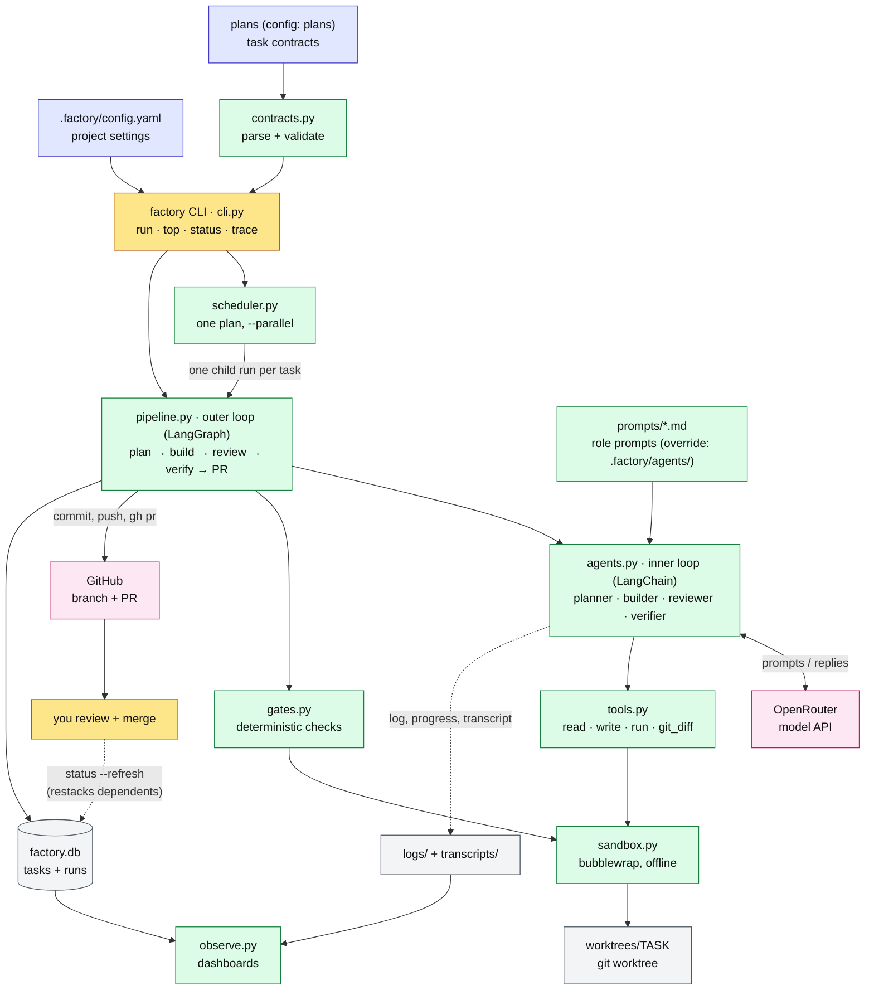
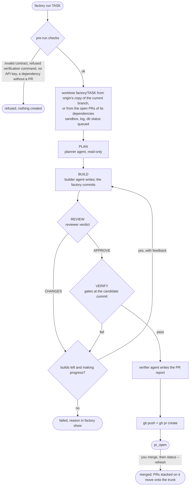
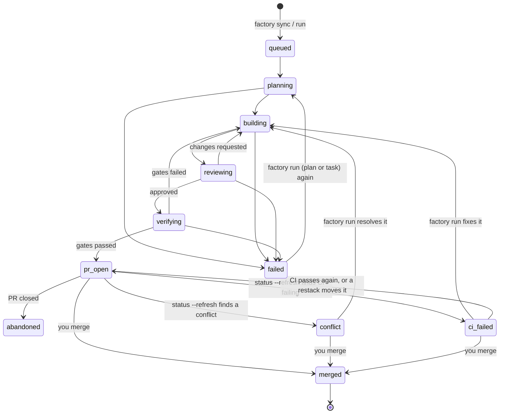
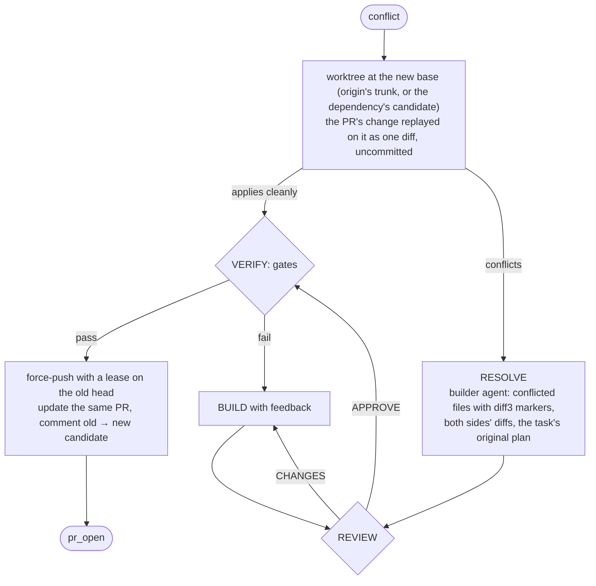
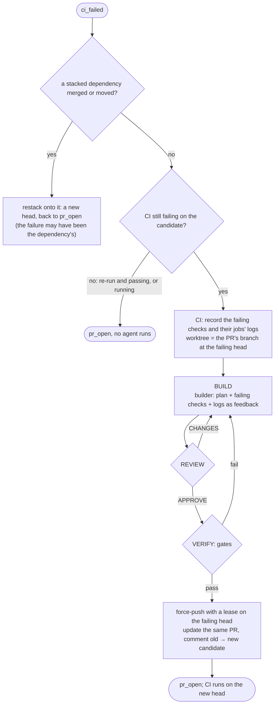
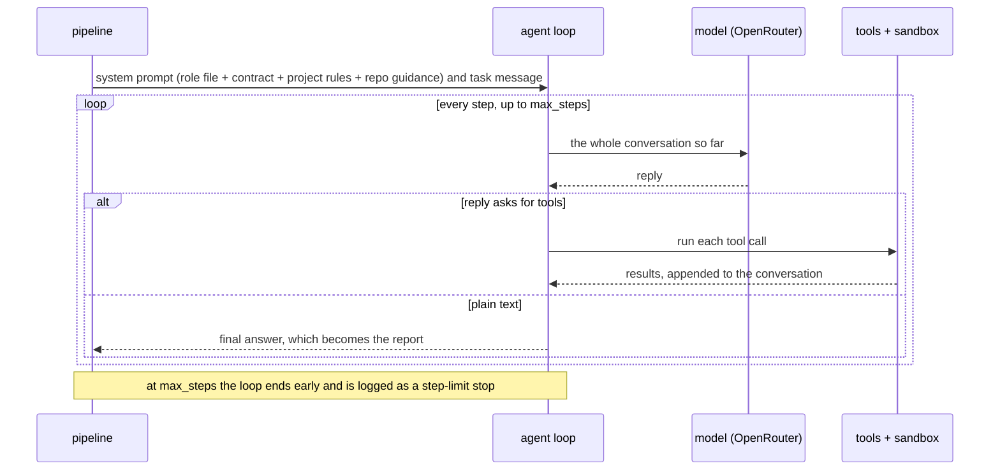

# Software factory

`factory run <plan>` takes every **task contract** in one of your repository's plans to a **working pull request** each, for you to review and merge. A task whose dependency isn't merged yet is built on top of the dependency's open PR (a stacked PR), so one run covers the whole plan. For each task, four AI agents, a planner, a builder, a reviewer and a verifier, work in an isolated, sandboxed git worktree. A PR is opened only when every deterministic check passes at the exact candidate commit. A human merging the PR is the approval.

Install it once, then run `factory init` in each repository that uses it. The factory is project-agnostic: its code, role prompts and workflow skills ship with it, and a repository holds only:
- `.factory/config.yaml`: where plans are, which tests every task must add, what runs as unit and e2e gates, the models per role, and what the sandbox mounts;
- the workflow skills under `.claude/skills/`, for Claude Code and OpenCode, linked under `.agents/skills/` for Codex: `plan-workstream` writes plans with task contracts, `review-task` reviews a task's PR, and `factory-ops` answers questions about operating the factory;
- its plans, and a short "Software factory" section in its agent guidance.

### Policy

- **Merging is the approval.** Agents never merge, push, commit to your checkout, or see secrets; a passing check alone approves nothing. Branch protection is a GitHub setting you own.
- **Gates decide.** A PR is opened only when every deterministic gate passes at the exact candidate commit. The verifier agent writes the PR report; it can't override a gate.
- **Isolation.** Agent commands and gates run under bubblewrap: read-only host, empty `$HOME`, `/tmp` and `/run`, cleared environment, no network unless asked. File tools stay in the worktree (reads also reach `dependency_sources`), and never write `.git`.
- **Scope is the reviewer's call.** The builder may edit any file in the worktree; the contract's goal and non-goals bound the change, and unrelated edits are findings.
- **Settings come from the main checkout,** never from a task worktree, so an agent can't weaken its own gates or change its own prompt.

---

## Quick start

```bash
# prerequisites: uv, bubblewrap (bwrap), git, gh (authenticated), your project's toolchain
uv tool install git+https://github.com/PaddyMc/software-factory   # once; `uv tool upgrade software-factory` later

cd your-repo
factory init                      # config, skills, starter plan, session log, AGENTS.md section (see below)
$EDITOR .factory/config.yaml      # plans location, e2e/session-log requirements, unit tests, models, sandbox
factory config                    # the effective settings

# write task contracts (/plan-workstream in Claude Code/OpenCode, $plan-workstream in Codex), then:
factory validate-plan
export OPENROUTER_API_KEY=sk-or-...
factory sync                      # load every task contract into the local db
factory status                    # the board, per plan: ready / waiting / running / PR open / failed
factory run <plan>                # every task of a plan, one PR each (a plan's file name or path)
factory top                       # live dashboard, per plan with task counters (another terminal)
factory status --refresh          # after you merge a PR: picks it up, moves the PRs stacked on it, flags conflicts and failing CI
factory run <task-id>             # one task, foreground
```

The agents' sandbox is offline, so fetch dependencies first (`cargo fetch`, `uv sync`, `npm ci`, …).

To work on the factory itself, install from a checkout instead: `uv tool install --editable /path/to/software-factory`, or `alias factory='uv run --project /path/to/software-factory factory'`.

### `factory init`

Run it at the root of a repository (any subdirectory works; it finds the main checkout). It writes:

| File | What |
|---|---|
| `.factory/config.yaml` | Settings, every key documented in comments. `name` is the directory name, `session_log: docs/sessions` is on, and `unit_tests` is guessed from `Cargo.toml` (`cargo test --workspace`) or `pyproject.toml` (`uv run pytest -q`) |
| `.claude/skills/{plan-workstream,review-task,factory-ops}/` | The workflow skills, copied from the installed factory |
| `.agents/skills/{plan-workstream,review-task,factory-ops}` | Relative symlinks to those same skill folders, for Codex discovery |
| `docs/sessions/README.md` | The session-log convention, when the directory is new or empty |
| `docs/plans/example.md` | When the repository has no plans yet: the contract format and one valid, runnable task. Replace or delete it before `factory run` |
| `AGENTS.md` | A "Software factory" section between `<!-- factory:begin -->` and `<!-- factory:end -->`. It goes into the first `guidance` file that exists (so a `CLAUDE.md`-only repository gets it there), and `AGENTS.md` is created when there is none |

Re-running is safe: existing files are kept (`keep … (exists; --force overwrites)`), and only the text between the markers is replaced. `--force` rewrites the files, which is how skills pick up a new factory version. `--no-skills` skips the skills, `--session-log DIR` picks another log directory, and `--no-session-log` turns the requirement off.

Codex links are also added when re-running `factory init` in a repository initialized by an older version. Existing files and directories at the Codex skill paths are preserved, even with `--force`; an existing symlink to a different target is replaced only with `--force`. To refresh the skill instructions for Codex after upgrading, use `factory init --force` (this also rewrites the other scaffolded files).

---

## Architecture



Colours:
- **yellow:** you;
- **blue:** your repository's inputs;
- **green:** factory code;
- **grey:** local state (`$FACTORY_HOME`);
- **pink:** external services.

Dotted lines are observability data, not control flow.

| Layer | Module | Responsibility |
|---|---|---|
| Entry | `cli.py` | Commands, pre-run checks (contract valid, factory-runnable, API keys present, dependencies merged or with open PRs), worktree setup, `status --refresh`, `init` and `config` |
| Settings | `config.py` | Load and validate `.factory/config.yaml` from the **main checkout** (never a task worktree, so an agent can't weaken its own gates) |
| Contracts | `contracts.py` | Read the fenced YAML in plans into `Task` objects (8 keys). Validate schema, IDs, dependencies across plans, command selection, placeholders |
| Scheduling | `scheduler.py` | Run one plan's tasks as child `factory run` processes, up to `--parallel`. A task starts once each dependency is merged or has an open PR |
| Stacking | `stack.py` | After a merge, rebase the PRs stacked on it onto the trunk and retarget them; edit PRs through the GitHub REST API |
| CI | `ci.py` | Read an open PR's checks at its head; the failing jobs' logs become the builder's feedback |
| Outer loop | `pipeline.py` | LangGraph state machine: plan → build → review → verify → PR / fail; resolve → review → verify for a conflicting PR; ci → build → review → verify for a PR whose CI fails. Commits the builder's work. Stops early when there is no progress |
| Inner loop | `agents.py` | One LangChain `create_agent` per role: loads the role prompt (the repository's override, else the shipped one), builds the system prompt (role + contract + project rules + repository guidance), streams steps, counts tokens and cost, records the transcript |
| Tools | `tools.py` | `read_file`, `list_dir`, `grep` (the worktree, plus `dependency_sources` read-only), `git_diff`, `write_file`/`edit_file` (anywhere in the worktree except `.git`), `run` (sandboxed; denied commands refused) |
| Checks | `gates.py`, `verification.py` | Conflict markers, plan untouched, and the configured session-log, e2e, unit and verification checks. Zero tests selected counts as failed |
| Isolation | `sandbox.py` | bubblewrap: read-only host, empty `$HOME`/`/tmp`/`/run`, cleared environment, no network unless asked |
| State | `db.py` | SQLite `tasks` (status, branch, SHAs, PR, pid, heartbeat, activity, cost) and `runs` (every role step: outcome, report, steps, tokens, cost, refused calls, transcript path) |
| Observability | `observe.py`, `log.py`, `prices.py` | Dashboard, merged logs, traces, transcripts, liveness, OpenRouter cost |

---

## Lifecycle of one task





What moves between agents is only what the pipeline hands over:

| From | To | What |
|---|---|---|
| Planner | Builder | The plan text |
| Reviewer (`VERDICT: CHANGES`) | Builder | The review, as feedback to address first |
| Gates (fail) | Builder | The failing gates' output, as feedback |
| Gates (pass) | Verifier | The gate table, for the PR report |
| CI (failing checks) | Builder | The failing checks and their jobs' logs, as feedback, on every attempt of a CI fix |

A build is retried up to `--max-attempts` times (default 3). The run stops earlier when the same gates fail with identical output twice in a row. A task that ends `failed` stays failed until you run it, or its plan, again; the rerun starts from a fresh worktree. `factory requeue TASK…` puts `failed` or `abandoned` tasks back to `queued` without running them.

## Merge conflicts

An open PR can stop applying to its base: another PR merged first and changed the same lines, or a stacked PR's dependency merged or moved. `factory status --refresh` finds both cases. It checks GitHub's `mergeable` for PRs on the trunk, and the restack rebase for stacked PRs. Either way the task becomes `conflict`. Running the task, or its plan, then resolves it instead of rebuilding:



- The planner doesn't run again: the builder gets the plan the PR was built from.
- A resolution is reviewed and gated like any build, and the `conflict_markers` gate fails on any `<<<<<<<`, `|||||||` or `>>>>>>>` line left in the diff. Only then is the PR updated. The push is leased on the PR's old head, so a commit someone pushed to the branch meanwhile is never overwritten.
- If the resolution fails, the PR keeps its old head and the task ends `failed`. Running it again rebuilds it from scratch on the trunk and updates the same PR. `factory run TASK --force` does the same straight away.
- Two open dependency PRs that conflict with each other are not resolved: the dependent waits until one merges (`cannot stack`).

## CI failures

The gates run before a PR opens. CI runs after, on every head the PR gets, including the rebased heads a restack pushes, which the gates never saw. CI can also check things the gates don't, such as formatting or lints. `factory status --refresh` reads each open PR's checks at its head (`gh pr view --json statusCheckRollup`). When a check fails on the factory's own candidate, the task becomes `ci_failed`. Running the task, or its plan, then fixes it:



- Only checks that ran on the factory's candidate count. If someone else pushed to the branch, the factory leaves the PR alone, and a `ci_failed` one goes back to `pr_open`. Cancelled, skipped and still-running checks don't count either.
- Logs come from GitHub Actions jobs, cut at the job's last `##[error]` line and capped at 8,000 characters each. Other checks only get their name and URL.
- The fix builds on the PR's head, not from scratch, so the planner doesn't run again. The gates measure the whole task diff against the PR's base, as before.
- A PR whose CI fails blocks its dependents, like a conflicting one: nothing new stacks on it until it's `pr_open` again.
- If the fix fails, the PR keeps its old head and the task ends `failed`. Running it again rebuilds it from scratch on the trunk and updates the same PR; `factory run TASK --force` does that straight away.

---

## Running a plan: stacked PRs

`factory run <plan>` (a plan's file name without `.md`, or its path) runs every task of the plan that has no PR yet, in dependency order, up to `--parallel` at once. Each task runs as its own child `factory run <task> --quiet` process, so one crash never stops the others.

A task starts once each of its dependencies is **merged or has an open PR**. When a dependency's PR is still open, the task is **stacked** on it:

- its worktree starts from the dependency's candidate commit (several open dependencies are merged together first; if they conflict, the task waits until one merges);
- its PR targets `factory/<dependency>`, so the PR shows only the task's own changes;
- its gates measure the diff and the new e2e test against that base.

```text
main ── t01 ◆ PR #10 (base main)
          └── t02 ◆ PR #11 (base factory/t01)
                └── t03 ◆ PR #12 (base factory/t02)
       t04 ◆ PR #13 (base main, independent of the others)
```

Review and merge from the bottom of each stack up. After each merge, run `factory status --refresh`. It picks up the merge and moves every PR stacked on the merged one: the PR's own commits are rebased onto the trunk (or onto its moved dependency) and the PR is retargeted, with a comment saying which commit the gates ran on. GitHub doesn't retarget stacked PRs on its own unless the repository deletes head branches on merge, so refresh before merging the next PR in a stack.

The run ends when nothing more can start, and prints each task's outcome and the PRs in merge order. Run the plan again to continue: tasks with PRs are kept, failed tasks run again, and tasks that waited on them start once they have PRs. `abandoned` tasks (holds) are skipped. Tasks whose verification the factory refuses are reported as manual.

---

## Inside one agent: the loop



- **Context grows every step.** Each step re-sends the entire conversation. In practice 95–98% of tokens are re-read input, and output is small. `factory trace` shows the growth step by step.
- **Step limits.** Each step is 4 LangGraph nodes (call-limit hook, model, call-limit hook, tools). `ModelCallLimitMiddleware` enforces `max_steps`; the graph recursion limit (`4 × max_steps + 25`) is only a backstop.
- **Recoverable errors.** These come back to the model as results so the agent can adjust:
  - a write into `.git` or outside the worktree, or a denied command, returns `refused: …`;
  - a failing tool call returns `error: …`.

  Both are flagged with ⚠ in the log.
- **Provider errors.** Rate limits, out-of-credit and network blips are retried with backoff (about 30 s). After that the run fails with the provider's real error.

### Roles

| Role | Default model (OpenRouter) | `max_steps` | Tools | Decides |
|---|---|---|---|---|
| planner | `z-ai/glm-5.3` | 40 | read | The implementation plan |
| builder | `deepseek/deepseek-v4-pro-0813` | 120 | read, write anywhere in the worktree except `.git`, sandboxed `run` | The change, or a conflicting PR's resolution |
| reviewer | `z-ai/glm-5.3` | 60 | read, `git_diff` | `VERDICT: APPROVE` or `CHANGES` (missing verdict = CHANGES) |
| verifier | `deepseek/deepseek-v4-flash-0731` | 30 | read, `git_diff`, sandboxed `run` | Nothing: it writes the PR report; **the gates decide** |

Set models and step limits per role with `models` and `max_steps` in `.factory/config.yaml`; `--model` overrides every role for one run. To replace a whole prompt, put it in `.factory/agents/<planner|builder|reviewer|verifier>.md` (frontmatter `model` and `max_steps` optional); the config's settings still win over its frontmatter. Any `provider:model` that LangChain's `init_chat_model` supports works, with the provider's key in the environment (`OPENROUTER_API_KEY`, `ANTHROPIC_API_KEY`, `OPENAI_API_KEY`).

The system prompt is assembled from four parts:
1. the role prompt, shipped in [`factory/prompts/`](factory/prompts/) or overridden by the repository;
2. the contract;
3. a **Project rules** block generated from `.factory/config.yaml`, telling the agent what the gates will require (session log, e2e test, unit commands);
4. the repository's own guidance: the first file of `guidance` that exists (default `AGENTS.md`, then `CLAUDE.md`).

The shipped role prompts therefore carry no project specifics.

No agent can commit, push, call `gh`, run `factory`, or touch the database. The pipeline does those things outside the sandbox.

---

## Configure a project

`.factory/config.yaml`. Every key is optional; `factory config` prints the effective values.

| Key | Default | Meaning |
|---|---|---|
| `name` | repo directory name | Names the state directory `~/.local/share/factory/<name>` |
| `home` | — | State directory override (`$FACTORY_HOME` wins over both) |
| `plans` | `["docs/plans/**/*.md"]` | Markdown files holding task contracts |
| `exclude` | `[]` | Globs never read as backlog (e.g. `docs/ideas/**`) |
| `guidance` | `["AGENTS.md", "CLAUDE.md"]` | Repository guidance: the first file that exists is appended to every agent's prompt |
| `session_log` | — | Directory: every task must add `<dir>/<today>.md` (`session_log` gate) |
| `e2e.dir` | — | Every task must add a new test directly under this directory (`e2e_written` gate) |
| `e2e.language` | `rust` | How new tests are found: `rust` (`#[test]`, `#[tokio::test]` fns) or `python` (`def test_*`) |
| `e2e.run_new` | — | Command run per new test; `{target}` = file stem, `{name}` = function, `{path}` = repo-relative file |
| `e2e.run_all` | — | The whole suite (used with `--full-e2e`, or when `run_all_when` matches) |
| `e2e.run_all_when` | `[]` | Regexes over changed paths that run the whole suite instead of only the new tests |
| `unit_tests` | `[]` | Commands for the `unit_tests` gate |
| `lockfiles` | common lockfiles | Files the `diff` gate notes when they change |
| `dependency_sources` | cargo registry and git sources, rustup toolchains | Directories the agents' file tools may also read, by absolute path (never write) |
| `models` | `{}` | Model per role (`plan`, `build`, `review`, `verify`), e.g. `{review: "anthropic:claude-…"}`; over the prompt's frontmatter |
| `max_steps` | `{}` | Model calls per agent run, per role; over the prompt's frontmatter |
| `denied_commands` | `[]` | Extra regexes the agents' `run` tool refuses (git push/commit/reset…, `sudo`, `gh`, `terraform apply/destroy` and `factory` are built in) |
| `sandbox.ro_binds` / `rw_binds` | rustup + uv read-only, `~/.cargo` writable | Host paths visible inside the sandbox (missing ones are skipped) |
| `sandbox.hide` | cargo credentials | Files masked with `/dev/null` |
| `sandbox.path` | `~/.cargo/bin`, `~/.local/bin` | Prepended to `PATH` |
| `sandbox.env` / `offline_env` | cargo/uv cache dirs / `CARGO_NET_OFFLINE`, `UV_OFFLINE` | Environment (`~` = home, `{cache}` = `$FACTORY_HOME/cache`); `offline_env` applies without `--network` |
| `sandbox.cache_dirs` | `target`, `uv` | Subdirectories of the shared cache to create |

**A Rust workspace** with a dedicated e2e crate (`my-e2e`); changes to the core crates run the whole e2e suite:

```yaml
name: my-chain
exclude: ["docs/ideas/**"]
session_log: docs/sessions
e2e:
  dir: crates/e2e/tests/
  language: rust
  run_new: "cargo test -p my-e2e --test {target} {name} -- --exact"
  run_all: "cargo test -p my-e2e"
  run_all_when: ['^crates/(core|consensus|node)/']
unit_tests: ["cargo test --workspace --exclude my-e2e"]
```

**A Python project:**

```yaml
name: shop
plans: ["planning/**/*.md"]
e2e:
  dir: tests/e2e/
  language: python
  run_new: "uv run pytest {path}::{name}"
  run_all: "uv run pytest tests/e2e"
unit_tests: ["uv run pytest -q tests/unit"]
sandbox:
  ro_binds: ["~/.local/bin", "~/.local/share/uv"]
  rw_binds: []
  env: {UV_CACHE_DIR: "{cache}/uv"}
  offline_env: {UV_OFFLINE: "1"}
```

---

## Task contracts

A plan carries a fenced `yaml` list. Each item has **exactly** these 8 keys; status lives in the database, never in the plan:

```yaml
- id: my-workstream-t01               # workstream-prefixed, unique across plans
  goal: "One observable deliverable"
  spec_refs: ["docs/spec/api.md#orders"]
  depends_on: []                      # task ids, may be in other plans; stacks on their open PRs, or waits
  non_goals: ["What not to do"]
  acceptance: ["Observable condition proving it is done"]
  verification: ["uv run pytest tests/e2e/test_orders.py::test_refund_flow"]
  risk: low                           # low | medium | high
```

`factory validate-plan` checks:
- schema;
- dependencies, including across plans and for cycles;
- command selection;
- placeholders.

It also warns about contracts whose verification runs a command the factory refuses (`terraform apply`, `sudo`, `gh`, `denied_commands`, …), and `factory run` refuses them: those tasks are done by hand.

Contracts don't fence the builder in: it can edit any file in the worktree. The goal and the non-goals bound the change, and the reviewer treats unrelated edits as findings. Plans without a task block are not executable. `/plan-workstream` writes plans in this shape (see [Skills](#skills)).

---

## Gates

They run in the sandbox against the exact candidate commit, in this order. Gates marked *configured* exist only when the project sets them up:

| Gate | Passes when |
|---|---|
| `clean` | Worktree HEAD is the candidate and the worktree has no uncommitted changes |
| `diff` | The candidate changes something. Changed `lockfiles` are noted |
| `conflict_markers` | No added line opens, splits or closes a merge-conflict hunk |
| `plan_untouched` | The task's plan doc was not edited |
| `session_log` *(configured)* | A `<session_log>/*.md` entry was added |
| `e2e_written` *(configured)* | A new test was added under `e2e.dir` |
| `verification` | Every command in the contract's `verification` passes |
| `unit_tests` *(configured)* | Every `unit_tests` command passes |
| `e2e_tests` *(configured)* | The new e2e tests pass by name (`run_new`), or the whole suite (`run_all`) with `--full-e2e` or when `run_all_when` matches |

A command that selects zero tests is **inconclusive, not a pass**. `factory gates <task> --ref <ref>` runs the same gates without agents, for reviewing hand-written work; `/review-task` builds on it.

---

## Skills

`factory init` copies three agent skills into `.claude/skills/`. Claude Code loads them there, and OpenCode reads the same directory. Relative links under `.agents/skills/` let Codex load the same files, including references and invocation policy. They read the project's `.factory/config.yaml`, so they carry no project specifics.

| Skill | Codex invocation | Use | What it does |
|---|---|---|---|
| [`/plan-workstream`](factory/templates/skills/plan-workstream/SKILL.md) | `$plan-workstream` | Before work starts | Grounds in the config, roadmap, plans and code; locks 2–4 strategic decisions with you; writes a plan whose contracts satisfy the configured gates; updates the roadmap; runs `factory validate-plan` |
| [`/review-task TASK [REF]`](factory/templates/skills/review-task/SKILL.md) | `$review-task TASK [REF]` | Before you merge | Runs `factory gates` (cheap, then full) on the task's branch, applies the reviewer agent's checklist, and reports APPROVE or REQUEST CHANGES. It never edits or merges |
| [`factory-ops`](factory/templates/skills/factory-ops/SKILL.md) | `$factory-ops` or automatic | While running | Loads by itself on operational questions: starting runs, what's happening, why a task failed, requeues, holds, merging stacked PRs, resetting the board |

`/plan-workstream` and `/review-task` are explicit-invocation only. The factory's own agents (planner, builder, reviewer, verifier) are role prompts, not skills, and stay in the installed package.

In Codex CLI or the IDE extension, type `$` to select a skill or select it through `/skills`. If newly installed skills do not appear, restart Codex. Codex uses `$plan-workstream` and `$review-task`; the bare slash names in the table are the Claude Code/OpenCode invocation syntax. See the [official Codex skills documentation](https://developers.openai.com/codex/skills/).

Use `factory init --no-skills` to skip the skills, and `factory init --force` to refresh them after upgrading the factory (it also rewrites the other scaffolded files, so review the diff).

---

## Sandbox

Agent `run` calls and gate commands execute under bubblewrap (`sandbox.py`):

- The host filesystem is read-only.
- `$HOME`, `/tmp` and `/run` are empty, so ssh keys, gh and cloud tokens, and the docker socket are invisible. Only the configured `sandbox` binds reappear.
- The environment is cleared, then set from `sandbox.env`.
- Writable: the task worktree, `$FACTORY_HOME/cache` and the `rw_binds`.
- **No network** unless `--network` is passed (or `--network-for` in the scheduler), so dependencies must already be cached.

`--no-sandbox` exists for machines without bubblewrap and is unsafe.

---

## Commands

| Command | Purpose |
|---|---|
| `factory init [--force] [--no-skills] [--session-log DIR \| --no-session-log]` | Set the repository up: config, skills, session log, starter plan, guidance section |
| `factory config` | Print the effective project settings |
| `factory prompt ROLE` | Print a role's prompt as the agents get it (the repository's override, else the shipped one), with its model |
| `factory validate-plan [PLAN…]` | Check contracts |
| `factory sync` | Load every contract from the plans into the db (statuses kept) |
| `factory status [PLAN] [--refresh] [--json]` | The board, grouped by plan with a task counter. `--refresh` picks up merged or closed PRs, takes up open or merged PRs opened from another board, moves stacked PRs whose dependencies merged, marks PRs that conflict with their base `conflict` and PRs whose CI fails `ci_failed`, and fails dead runs |
| `factory run PLAN [--parallel N] [--network-for T1,T2] [flags]` | Every task of the plan without a PR, one PR each, dependents stacked on open dependency PRs; PRs in `conflict` get their conflicts resolved, and PRs in `ci_failed` get their CI fixed |
| `factory run TASK [flags]` | Run one task in the foreground (stacked the same way). On a `conflict` task it resolves the conflicts, and on a `ci_failed` task it fixes CI; `--force` rebuilds it instead |
| `factory top [PLAN] [--once]` | Live dashboard: each active plan with its glyph strip (✓ merged ◆ PR open ≠ PR conflicts ! CI fails ▶ running ✗ failed · queued ⊘ held) and counter, then its tasks' progress, current action, elapsed and quiet time, cost; recent events |
| `factory logs TASK [-f] [-n N]` / `factory logs --all -f` | One task's log, or every task's log merged |
| `factory trace TASK [--role R] [--attempt N] [--all]` | Per-step model time, tool time, context size, cached tokens, output, cost, calls, largest results |
| `factory transcript TASK [--role R] [--attempt N] [--all] [--full]` | Exactly what the model saw and did |
| `factory show TASK [--role R]` | Every step's report and stats |
| `factory gates TASK [--ref R] [--base B] [--skip …]` | Deterministic gates only, in a throwaway worktree. The base defaults to the PR a stacked task is built on, else the default branch |
| `factory requeue TASK…` | Put `failed` or `abandoned` tasks back to `queued` so the next plan run picks them up (refuses running, open-PR and merged tasks) |
| `factory clean TASK` | Remove a task's worktree |
| `factory abandon TASK` | Mark a task abandoned (a hold: plan runs skip it) |
| `factory check-output --cmd C --exit N LOG` | Classify a test log (for CI) |

Useful `run` flags:

| Flag | Effect |
|---|---|
| `--base B` | Branch for the worktree and PR (default: current branch) |
| `--model M` | Override every role's model |
| `--max-attempts N` | Build attempts (default 3) |
| `--max-cost USD` | Abort the task above this cost |
| `--network` | Allow network in the sandbox |
| `--no-pr` | Stop after the gates pass, without pushing |
| `--skip-gates a,b` | Skip the named gates |
| `--full-e2e` | Always run the whole e2e suite |
| `--notify` | Desktop notification when the run ends |
| `--quiet` | Log to the file only |
| `--force` | Run even if the status, or a dependency without a PR, would refuse |

---

## Where things live

| Path | Contents |
|---|---|
| `$FACTORY_HOME/factory.db` | All task state (migrates older schemas in place) |
| `$FACTORY_HOME/worktrees/TASK/` | The task's git worktree on branch `factory/TASK` |
| `$FACTORY_HOME/logs/TASK.log` | Stage changes, agent messages, tool calls, gate results |
| `$FACTORY_HOME/transcripts/TASK/NNNNN-ROLE-ATTEMPT.jsonl` | Full transcript per role step (system prompt, messages, tool calls and results, usage, cost) |
| `$FACTORY_HOME/cache/` | Shared build caches, OpenRouter price list (refreshed daily) |

`FACTORY_HOME` defaults to `~/.local/share/factory/<name>` (or the config's `home`). Set it to keep a separate board, for example for experiments.

**Several maintainers.** Each keeps their own board; GitHub is what they share. `factory sync && factory status --refresh` (and every plan run, which starts with a refresh) takes up the factory PRs this board didn't open: a `queued` or `failed` task with an open PR on `factory/TASK` becomes `pr_open`, with its candidate, base and stack read from the PR and its branch, and one with a merged PR becomes `merged`. Closed PRs are history and are ignored; holds (`abandoned`) and running tasks are left alone. Logs, transcripts and costs stay with the board that ran the task.

---

## Troubleshooting

| Symptom | Cause, and what to do |
|---|---|
| `… which the factory refuses; run it by hand` | The contract's verification runs a denied command. Do the task by hand, or `--skip-gates verification` |
| `.factory/config.yaml: unknown key …` | A typo in the config; `factory config` shows what was understood |
| Status `DEAD` | The `factory run` process died (killed, crashed). `factory status --refresh` marks it failed; run the task or its plan again |
| `cannot stack TASK: its open dependencies conflict` | Merge one of the dependencies' PRs, `factory status --refresh`, then run again |
| Status `conflict` | The PR no longer applies to its base. `factory run TASK` (or its plan) resolves it; see [Merge conflicts](#merge-conflicts) |
| A conflict resolution `failed` | The PR still holds its old head. Run the task again to rebuild it from scratch on the trunk |
| Status `ci_failed` | CI fails on the PR's head. `factory show TASK --role ci` names the checks and shows the logs; `factory run TASK` (or its plan) fixes them; see [CI failures](#ci-failures) |
| `… not the factory's candidate: someone pushed to it` | A commit the factory didn't make is on the PR branch, so its CI isn't the factory's to fix. Fix it there, or `factory run TASK --force` to rebuild |
| A CI fix `failed` | The PR still holds the failing head. Run the task again to rebuild it from scratch on the trunk |
| `⚠ stopped: step limit` in the log | The agent used `max_steps`. Raise it with `max_steps: {ROLE: N}` in `.factory/config.yaml`, or narrow the task |
| Gates fail on network or dependency fetches | The sandbox is offline. Fetch dependencies first, or pass `--network` for tasks that download |
| A tool is "not found" inside the sandbox | It lives under `$HOME`, which is hidden. Add its directory to `sandbox.ro_binds` and `sandbox.path` |
| `set OPENROUTER_API_KEY first` | Export the key for the providers the roles use (`factory run` lists them) |
| `error: PaymentRequiredResponseError: … available credits` | OpenRouter credits ran out. Parallel runs reserve credit for their in-flight requests, so this can appear before the balance hits zero. Add credits, then run the plan again |
| `error: … ConnectError` / `name resolution` | Network outage. Model calls are retried with backoff for about 30 s before the run fails; run the plan again once it's back |
| A plan run leaves a task `queued` | A dependency has no PR (it failed, is held, or is in another plan). `factory status PLAN` shows what it waits for |
| A stacked PR shows its dependency's changes | Its dependency merged but its commits didn't rebase cleanly, so it is `conflict` and targets the trunk already. Run the task to resolve it |
| Costs show `-` | The model isn't on OpenRouter's price list, or the list couldn't be fetched |

---

## Development

```bash
uv run pytest -q tests
```

- **`tests/test_pipeline.py`** drives the **real** CLI, LangGraph pipeline, LangChain agents and tools, git, bubblewrap, a bare `origin` and a fake `gh`. Only the model is replaced: `tests/fake_model.py` is a `ScriptedModel` that reads the system prompt to know which role it's playing.
- **Other suites** cover:
  - config, init and the shipped templates and skills;
  - contracts, dependencies and paths;
  - gates (Rust and Python e2e detection, unconfigured gates);
  - the sandbox, tools and the database;
  - observability, the agent loop, plan runs, stacking, PR take-up, conflict replay and CI fixes.
- **CI:** `.github/workflows/ci.yml`.

The agent interface is a single seam: a role receives a `Ctx` with `log`, `progress` and `record` callbacks and returns an `Output`. Replacing LangChain with another runner means implementing the `Roles` protocol in `agents.py`.

## Known limitations and next steps

- **The reviewer runs before the gates**, so it can approve builds that then fail mechanical checks. Planned: gates first.
- **Context cost:** whole files stay in context for every later step. Planned: capped tool output, a slimmer system prompt, summarizing old steps.
- **The builder re-explores what the planner already read.** Planned: the planner hands over exact files and line ranges.
- **Conflicts and CI failures are found on refresh, not live.** GitHub computes `mergeable` lazily, so a PR that just started conflicting may show up one `status --refresh` later.
- **Restacked PRs aren't re-gated.** After a rebase the PR comment names the commit the gates ran on. CI runs on the new one, and a refresh marks it `ci_failed` if that fails.
- **A CI fix is gated, but the gates can't run CI's own checks.** The builder is told to reproduce each failure with `run`, and CI on the new head decides. A fix that doesn't hold shows up red again on the next refresh.
- **Two boards can run the same task at once.** Nothing claims a task across boards. Planned: a draft PR as the claim.
- **A PR stacked on several dependencies is taken up as stacked on the one it targets**, since the others are merged into its branch and the PR doesn't name them.
- **Linux only**: the sandbox is bubblewrap.
- **Branch protection** on your default branch is a GitHub setting; the factory and CI report, they don't enforce merges.

Gaps compared with similar projects, and what to build next: [`NEXT.md`](NEXT.md).

---

Extracted from the Cleartree project's factory, which keeps its own project-specific copy.
