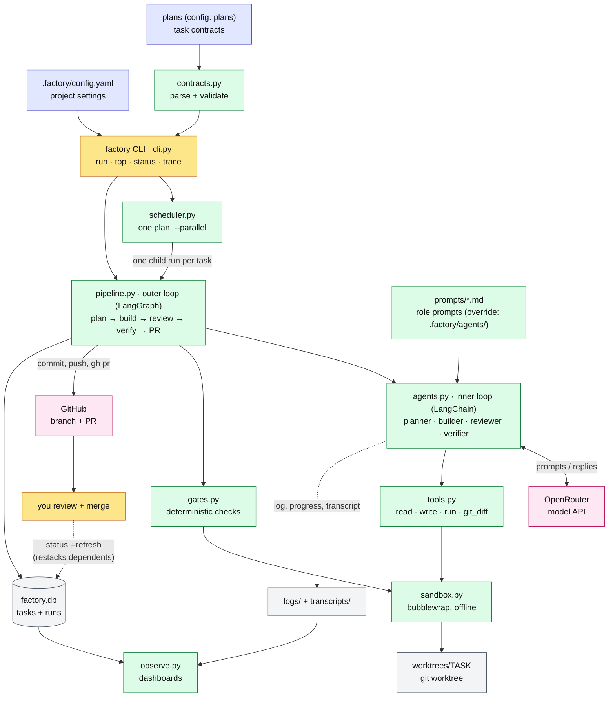
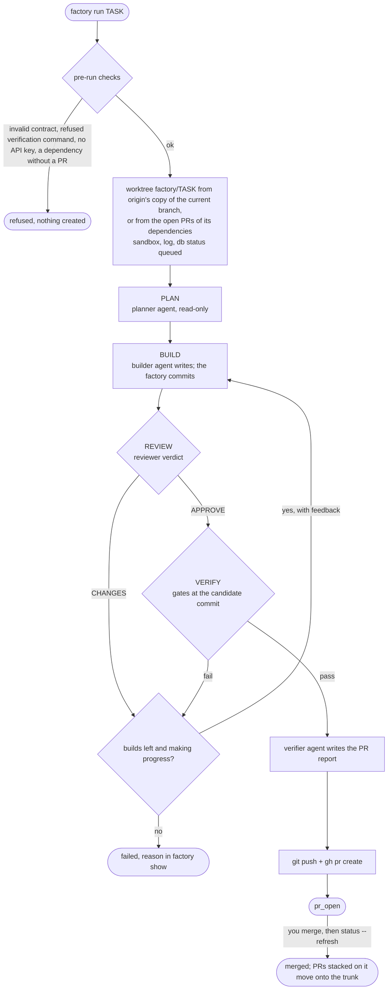
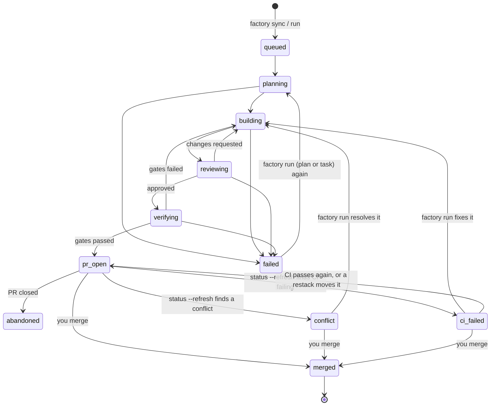
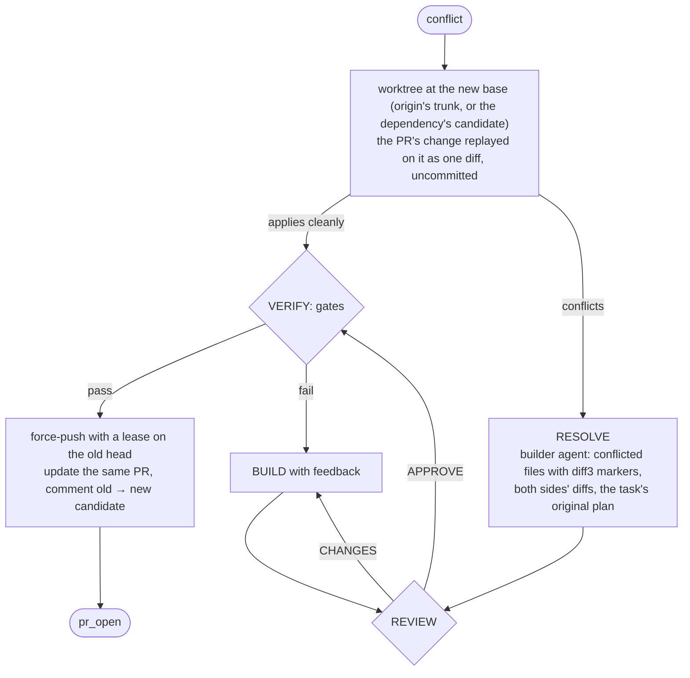
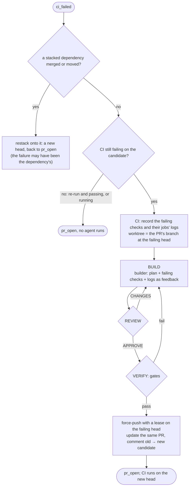
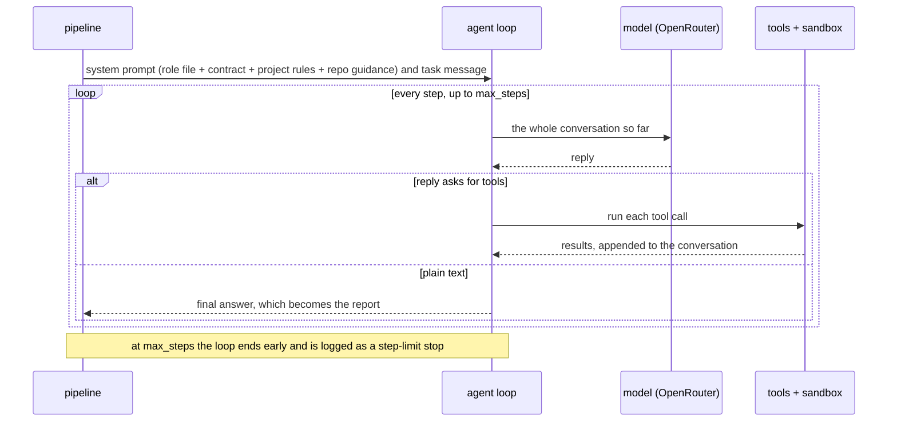

# Architecture

How the factory takes a task contract to a pull request. To install and run it, see the [README](../README.md); for configuration, contracts and commands, see the [reference](reference.md).

---

## Policy

- **Merging is the approval.** Agents never merge, push, commit to your checkout, or see secrets; a passing check alone approves nothing. Branch protection is a GitHub setting you own.
- **Gates decide.** A PR is opened only when every deterministic gate passes at the exact candidate commit. The verifier agent writes the PR report; it can't override a gate.
- **Isolation.** Agent commands and gates run under bubblewrap: read-only host, empty `$HOME`, `/tmp` and `/run`, cleared environment, no network unless asked. File tools stay in the worktree (reads also reach `dependency_sources`), and never write `.git`.
- **Scope is the reviewer's call.** The builder may edit any file in the worktree; the contract's goal and non-goals bound the change, and unrelated edits are findings.
- **Settings come from the main checkout,** never from a task worktree, so an agent can't weaken its own gates or change its own prompt.

---

## Components



Colours:
- **yellow:** you;
- **blue:** your repository's inputs;
- **green:** factory code;
- **grey:** local state (`$FACTORY_HOME`);
- **pink:** external services.

Dotted lines are observability data, not control flow.

| Layer | Module | Responsibility |
|---|---|---|
| Entry | `cli.py` | Commands, pre-run checks (contract valid, factory-runnable, API keys present, dependencies merged or with open PRs), worktree setup, `status --refresh`, `init` and `config` |
| Settings | `config.py` | Load and validate `.factory/config.yaml` from the **main checkout** (never a task worktree, so an agent can't weaken its own gates) |
| Contracts | `contracts.py` | Read the fenced YAML in plans into `Task` objects (8 keys). Validate schema, IDs, dependencies across plans, command selection, placeholders |
| Scheduling | `scheduler.py` | Run one plan's tasks as child `factory run` processes, up to `--parallel`. A task starts once each dependency is merged or has an open PR |
| Stacking | `stack.py` | After a merge, rebase the PRs stacked on it onto the trunk and retarget them; edit PRs through the GitHub REST API |
| CI | `ci.py` | Read an open PR's checks at its head; the failing jobs' logs become the builder's feedback |
| Outer loop | `pipeline.py` | LangGraph state machine: plan → build → review → verify → PR / fail; resolve → review → verify for a conflicting PR; ci → build → review → verify for a PR whose CI fails. Commits the builder's work. Stops early when there is no progress |
| Inner loop | `agents.py` | One LangChain `create_agent` per role: loads the role prompt (the repository's override, else the shipped one), builds the system prompt (role + contract + project rules + repository guidance), streams steps, counts tokens and cost, records the transcript |
| Tools | `tools.py` | `read_file`, `list_dir`, `grep` (the worktree, plus `dependency_sources` read-only), `git_diff`, `write_file`/`edit_file` (anywhere in the worktree except `.git`), `run` (sandboxed; denied commands refused) |
| Checks | `gates.py`, `verification.py` | Conflict markers, plan untouched, and the configured session-log, e2e, unit and verification checks. Zero tests selected counts as failed |
| Isolation | `sandbox.py` | bubblewrap: read-only host, empty `$HOME`/`/tmp`/`/run`, cleared environment, no network unless asked |
| State | `db.py` | SQLite `tasks` (status, branch, SHAs, PR, pid, heartbeat, activity, cost) and `runs` (every role step: outcome, report, steps, tokens, cost, refused calls, transcript path) |
| Observability | `observe.py`, `log.py`, `prices.py` | Dashboard, merged logs, traces, transcripts, liveness, OpenRouter cost |

---

## Lifecycle of one task





What moves between agents is only what the pipeline hands over:

| From | To | What |
|---|---|---|
| Planner | Builder | The plan text |
| Reviewer (`VERDICT: CHANGES`) | Builder | The review, as feedback to address first |
| Gates (fail) | Builder | The failing gates' output, as feedback |
| Gates (pass) | Verifier | The gate table, for the PR report |
| CI (failing checks) | Builder | The failing checks and their jobs' logs, as feedback, on every attempt of a CI fix |

A build is retried up to `--max-attempts` times (default 3). The run stops earlier when the same gates fail with identical output twice in a row. A task that ends `failed` stays failed until you run it, or its plan, again; the rerun starts from a fresh worktree. `factory requeue TASK…` puts `failed` or `abandoned` tasks back to `queued` without running them.

---

## Merge conflicts

An open PR can stop applying to its base: another PR merged first and changed the same lines, or a stacked PR's dependency merged or moved. `factory status --refresh` finds both cases. It checks GitHub's `mergeable` for PRs on the trunk, and the restack rebase for stacked PRs. Either way the task becomes `conflict`. Running the task, or its plan, then resolves it instead of rebuilding:



- The planner doesn't run again: the builder gets the plan the PR was built from.
- A resolution is reviewed and gated like any build, and the `conflict_markers` gate fails on any `<<<<<<<`, `|||||||` or `>>>>>>>` line left in the diff. Only then is the PR updated. The push is leased on the PR's old head, so a commit someone pushed to the branch meanwhile is never overwritten.
- If the resolution fails, the PR keeps its old head and the task ends `failed`. Running it again rebuilds it from scratch on the trunk and updates the same PR. `factory run TASK --force` does the same straight away.
- Two open dependency PRs that conflict with each other are not resolved: the dependent waits until one merges (`cannot stack`).

---

## CI failures

The gates run before a PR opens. CI runs after, on every head the PR gets, including the rebased heads a restack pushes, which the gates never saw. CI can also check things the gates don't, such as formatting or lints. `factory status --refresh` reads each open PR's checks at its head (`gh pr view --json statusCheckRollup`). When a check fails on the factory's own candidate, the task becomes `ci_failed`. Running the task, or its plan, then fixes it:



- Only checks that ran on the factory's candidate count. If someone else pushed to the branch, the factory leaves the PR alone, and a `ci_failed` one goes back to `pr_open`. Cancelled, skipped and still-running checks don't count either.
- Logs come from GitHub Actions jobs, cut at the job's last `##[error]` line and capped at 8,000 characters each. Other checks only get their name and URL.
- The fix builds on the PR's head, not from scratch, so the planner doesn't run again. The gates measure the whole task diff against the PR's base, as before.
- A PR whose CI fails blocks its dependents, like a conflicting one: nothing new stacks on it until it's `pr_open` again.
- If the fix fails, the PR keeps its old head and the task ends `failed`. Running it again rebuilds it from scratch on the trunk and updates the same PR; `factory run TASK --force` does that straight away.

---

## Running a plan: stacked PRs

`factory run <plan>` (a plan's file name without `.md`, or its path) runs every task of the plan that has no PR yet, in dependency order, up to `--parallel` at once. Each task runs as its own child `factory run <task> --quiet` process, so one crash never stops the others.

A task starts once each of its dependencies is **merged or has an open PR**. When a dependency's PR is still open, the task is **stacked** on it:

- its worktree starts from the dependency's candidate commit (several open dependencies are merged together first; if they conflict, the task waits until one merges);
- its PR targets `factory/<dependency>`, so the PR shows only the task's own changes;
- its gates measure the diff and the new e2e test against that base.

```text
main ── t01 ◆ PR #10 (base main)
          └── t02 ◆ PR #11 (base factory/t01)
                └── t03 ◆ PR #12 (base factory/t02)
       t04 ◆ PR #13 (base main, independent of the others)
```

Review and merge from the bottom of each stack up. After each merge, run `factory status --refresh`. It picks up the merge and moves every PR stacked on the merged one: the PR's own commits are rebased onto the trunk (or onto its moved dependency) and the PR is retargeted, with a comment saying which commit the gates ran on. GitHub doesn't retarget stacked PRs on its own unless the repository deletes head branches on merge, so refresh before merging the next PR in a stack.

The run ends when nothing more can start, and prints each task's outcome and the PRs in merge order. Run the plan again to continue: tasks with PRs are kept, failed tasks run again, and tasks that waited on them start once they have PRs. `abandoned` tasks (holds) are skipped. Tasks whose verification the factory refuses are reported as manual.

---

## Inside one agent: the loop



- **Context grows every step.** Each step re-sends the entire conversation. In practice 95–98% of tokens are re-read input, and output is small. `factory trace` shows the growth step by step.
- **Step limits.** Each step is 4 LangGraph nodes (call-limit hook, model, call-limit hook, tools). `ModelCallLimitMiddleware` enforces `max_steps`; the graph recursion limit (`4 × max_steps + 25`) is only a backstop.
- **Recoverable errors.** These come back to the model as results so the agent can adjust:
  - a write into `.git` or outside the worktree, or a denied command, returns `refused: …`;
  - a failing tool call returns `error: …`.

  Both are flagged with ⚠ in the log.
- **Provider errors.** Rate limits, out-of-credit and network blips are retried with backoff (about 30 s). After that the run fails with the provider's real error.

### Roles

| Role | Default model (OpenRouter) | `max_steps` | Tools | Decides |
|---|---|---|---|---|
| planner | `z-ai/glm-5.3` | 40 | read | The implementation plan |
| builder | `deepseek/deepseek-v4-pro-0813` | 120 | read, write anywhere in the worktree except `.git`, sandboxed `run` | The change, or a conflicting PR's resolution |
| reviewer | `z-ai/glm-5.3` | 60 | read, `git_diff` | `VERDICT: APPROVE` or `CHANGES` (missing verdict = CHANGES) |
| verifier | `deepseek/deepseek-v4-flash-0731` | 30 | read, `git_diff`, sandboxed `run` | Nothing: it writes the PR report; **the gates decide** |

Set models and step limits per role with `models` and `max_steps` in `.factory/config.yaml`; `--model` overrides every role for one run. To replace a whole prompt, put it in `.factory/agents/<planner|builder|reviewer|verifier>.md` (frontmatter `model` and `max_steps` optional); the config's settings still win over its frontmatter. Any `provider:model` that LangChain's `init_chat_model` supports works, with the provider's key in the environment (`OPENROUTER_API_KEY`, `ANTHROPIC_API_KEY`, `OPENAI_API_KEY`).

The system prompt is assembled from four parts:
1. the role prompt, shipped in [`factory/prompts/`](../factory/prompts/) or overridden by the repository;
2. the contract;
3. a **Project rules** block generated from `.factory/config.yaml`, telling the agent what the gates will require (session log, e2e test, unit commands);
4. the repository's own guidance: the first file of `guidance` that exists (default `AGENTS.md`, then `CLAUDE.md`).

The shipped role prompts therefore carry no project specifics.

No agent can commit, push, call `gh`, run `factory`, or touch the database. The pipeline does those things outside the sandbox.

---

## Gates

They run in the sandbox against the exact candidate commit, in this order. Gates marked *configured* exist only when the project sets them up:

| Gate | Passes when |
|---|---|
| `clean` | Worktree HEAD is the candidate and the worktree has no uncommitted changes |
| `diff` | The candidate changes something. Changed `lockfiles` are noted |
| `conflict_markers` | No added line opens, splits or closes a merge-conflict hunk |
| `plan_untouched` | The task's plan doc was not edited |
| `session_log` *(configured)* | A `<session_log>/*.md` entry was added |
| `e2e_written` *(configured)* | A new test was added under `e2e.dir` |
| `verification` | Every command in the contract's `verification` passes |
| `unit_tests` *(configured)* | Every `unit_tests` command passes |
| `e2e_tests` *(configured)* | The new e2e tests pass by name (`run_new`), or the whole suite (`run_all`) with `--full-e2e` or when `run_all_when` matches |

A command that selects zero tests is **inconclusive, not a pass**. `factory gates <task> --ref <ref>` runs the same gates without agents, for reviewing hand-written work; `/review-task` builds on it ([skills](reference.md#skills)).

---

## Sandbox

Agent `run` calls and gate commands execute under bubblewrap (`sandbox.py`):

- The host filesystem is read-only.
- `$HOME`, `/tmp` and `/run` are empty, so ssh keys, gh and cloud tokens, and the docker socket are invisible. Only the configured `sandbox` binds reappear.
- The environment is cleared, then set from `sandbox.env`.
- Writable: the task worktree, `$FACTORY_HOME/cache` and the `rw_binds`.
- **No network** unless `--network` is passed (or `--network-for` in the scheduler), so dependencies must already be cached.

`--no-sandbox` exists for machines without bubblewrap and is unsafe.

---

## Development

Run the tests with `uv run pytest -q tests`.

- **`tests/test_pipeline.py`** drives the **real** CLI, LangGraph pipeline, LangChain agents and tools, git, bubblewrap, a bare `origin` and a fake `gh`. Only the model is replaced: `tests/fake_model.py` is a `ScriptedModel` that reads the system prompt to know which role it's playing.
- **Other suites** cover:
  - config, init and the shipped templates and skills;
  - contracts, dependencies and paths;
  - gates (Rust and Python e2e detection, unconfigured gates);
  - the sandbox, tools and the database;
  - observability, the agent loop, plan runs, stacking, PR take-up, conflict replay and CI fixes.
- **CI:** `.github/workflows/ci.yml`.

The agent interface is a single seam: a role receives a `Ctx` with `log`, `progress` and `record` callbacks and returns an `Output`. Replacing LangChain with another runner means implementing the `Roles` protocol in `agents.py`.

---

## Known limitations and next steps

- **The reviewer runs before the gates**, so it can approve builds that then fail mechanical checks. Planned: gates first.
- **Context cost:** whole files stay in context for every later step. Planned: capped tool output, a slimmer system prompt, summarizing old steps.
- **The builder re-explores what the planner already read.** Planned: the planner hands over exact files and line ranges.
- **Conflicts and CI failures are found on refresh, not live.** GitHub computes `mergeable` lazily, so a PR that just started conflicting may show up one `status --refresh` later.
- **Restacked PRs aren't re-gated.** After a rebase the PR comment names the commit the gates ran on. CI runs on the new one, and a refresh marks it `ci_failed` if that fails.
- **A CI fix is gated, but the gates can't run CI's own checks.** The builder is told to reproduce each failure with `run`, and CI on the new head decides. A fix that doesn't hold shows up red again on the next refresh.
- **Two boards can run the same task at once.** Nothing claims a task across boards. Planned: a draft PR as the claim.
- **A PR stacked on several dependencies is taken up as stacked on the one it targets**, since the others are merged into its branch and the PR doesn't name them.
- **Linux only**: the sandbox is bubblewrap.
- **Branch protection** on your default branch is a GitHub setting; the factory and CI report, they don't enforce merges.

Gaps compared with similar projects, and what to build next: [`NEXT.md`](../NEXT.md).
