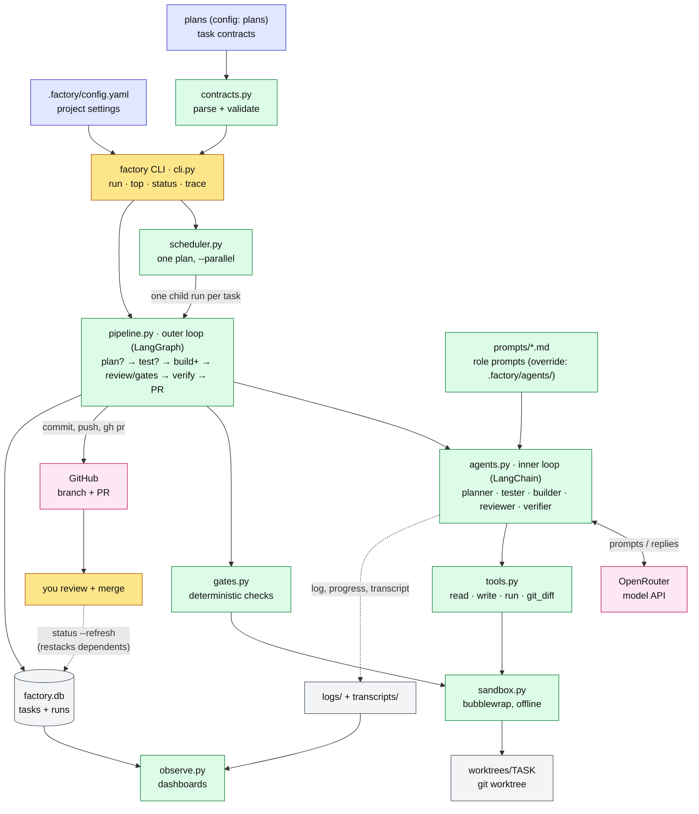
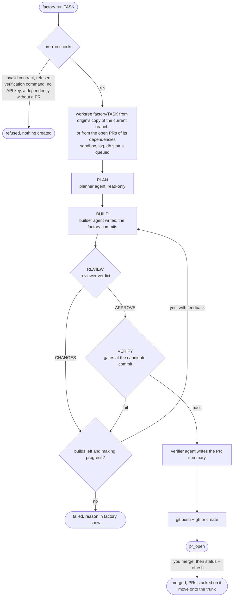
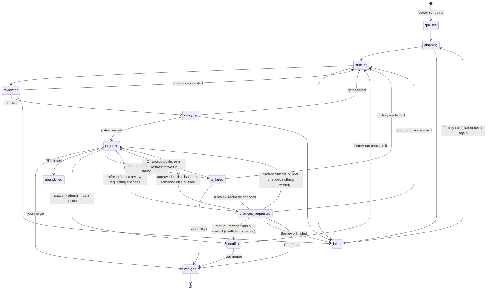
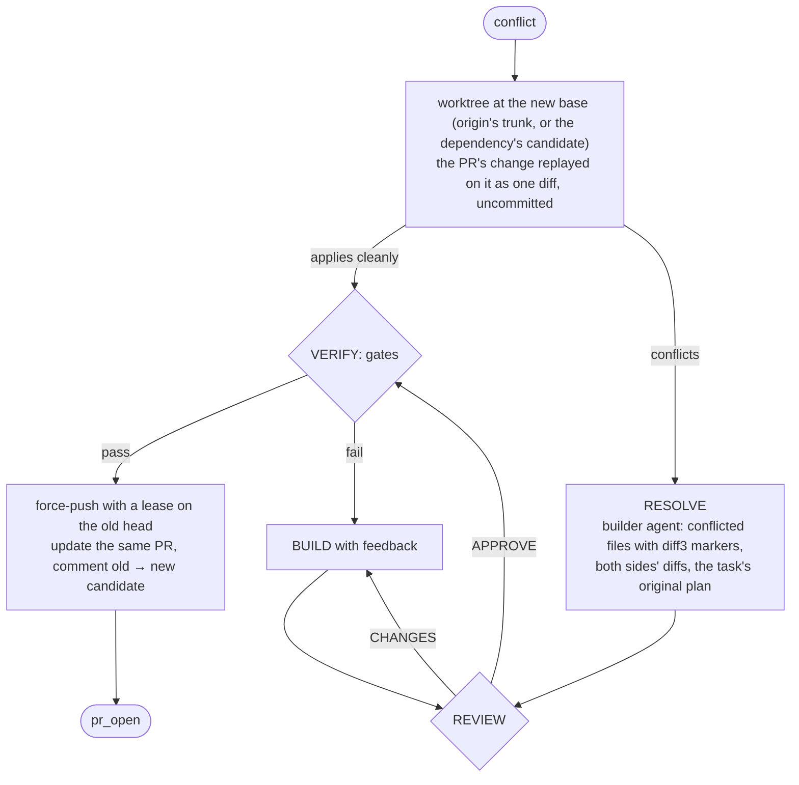
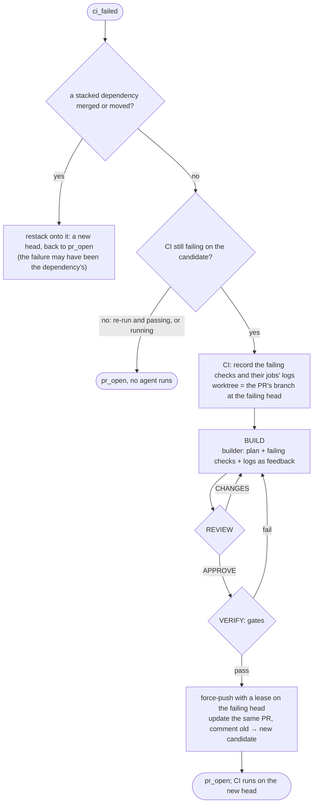
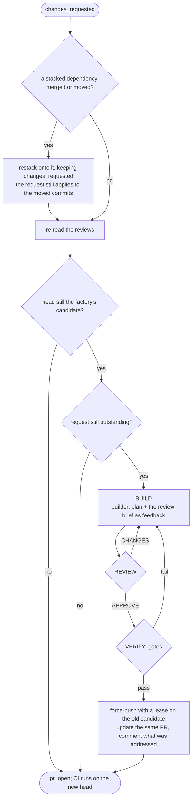
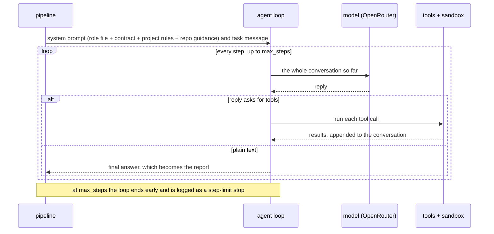
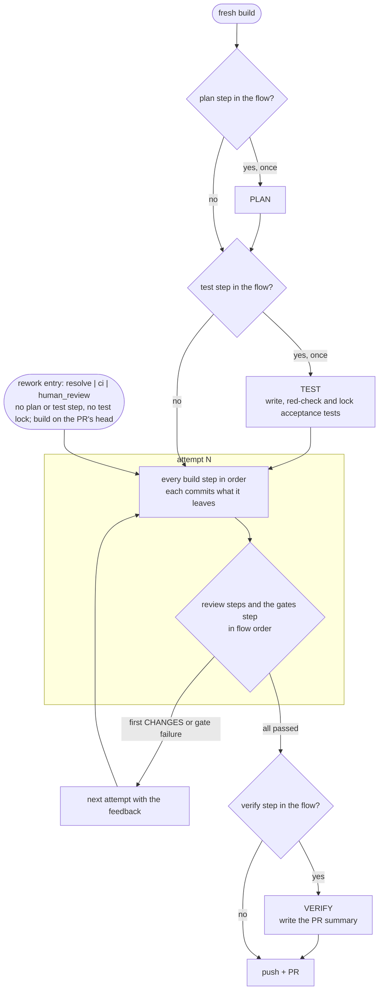

# Architecture

How the factory takes a task contract to a pull request. To install and run it, see the [README](../README.md); for configuration, contracts and commands, see the [reference](reference.md).

---

## Policy

- **Merging is the approval.** Agents never merge, push, commit to your checkout, or see secrets; a passing check alone approves nothing. Branch protection is a GitHub setting you own.
- **Gates decide.** A PR is opened only when every deterministic gate passes at the exact candidate commit. The verifier agent writes the PR's title and summary; it can't override a gate.
- **Isolation.** Agent commands and gates run under bubblewrap: read-only host, empty `$HOME`, `/tmp` and `/run`, cleared environment, no network unless asked. File tools stay in the worktree (reads also reach `dependency_sources`), and never write `.git`.
- **Scope is the reviewer's call.** The builder may edit any file in the worktree; the contract's goal and non-goals bound the change, and unrelated edits are findings.
- **Settings come from the main checkout,** never from a task worktree, so an agent can't weaken its own gates or change its own prompt.

---

## Components



Colours:
- **yellow:** you;
- **blue:** your repository's inputs;
- **green:** factory code;
- **grey:** local state (`$FACTORY_HOME`);
- **pink:** external services.

Dotted lines are observability data, not control flow.

| Layer | Module | Responsibility |
|---|---|---|
| Entry | `cli.py` | Commands, pre-run checks (contract valid, factory-runnable, API keys present, dependencies merged or with open PRs), worktree setup, `status --refresh`, `init` and `config` |
| Settings | `config.py` | Load and validate `.factory/config.yaml` from the **main checkout** (never a task worktree, so an agent can't weaken its own gates) |
| Flows | `flows.py` | Parse and validate named flows from `flows:` (step kinds, names, models, step limits, `loop`, `prove` and order rules), hold the built-in `default` and `strict` flows, and insert a gates step when one is omitted |
| Contracts | `contracts.py` | Read the fenced YAML in plans into `Task` objects (8 keys). Validate schema, IDs, dependencies across plans, command selection, placeholders |
| Scheduling | `scheduler.py` | Run one plan's tasks as child `factory run` processes, up to `--parallel`. A task starts once each dependency is merged or has an open PR |
| Stacking | `stack.py` | After a merge, rebase the PRs stacked on it onto the trunk and retarget them; edit PRs through the GitHub REST API |
| CI | `ci.py` | Read an open PR's checks at its head; the failing jobs' logs become the builder's feedback |
| Outer loop | `pipeline.py` | LangGraph state machine: optional plan and test steps → build attempts → reviews and gates in flow order → optional verify → PR / fail; resolve and ci/review rework enter on the PR's head without plan, test or the acceptance lock. Commits the tester's and builder's work. Stops early when there is no progress |
| Inner loop | `agents.py` | One LangChain `create_agent` per role: loads the role prompt (the repository's override, else the shipped one), builds the system prompt (role + contract + project rules + repository guidance), streams steps, counts tokens and cost, records the transcript |
| Tools | `tools.py` | `read_file`, `list_dir`, `grep` (the worktree, plus `dependency_sources` read-only), `git_diff`, `write_file`/`edit_file` (builders anywhere in the worktree except `.git`, testers under `test_paths`), `run` (sandboxed; denied commands refused) |
| Checks | `gates.py`, `verification.py` | Conflict markers, plan untouched, the test commit's `acceptance_untouched` lock, and the configured session-log, e2e, unit and verification checks. Zero tests selected counts as failed |
| GitHub | `github.py` | Which identity: a `GH_TOKEN`/`GITHUB_TOKEN` when set (`gh` reads it; git's github.com fetches and pushes go over HTTPS with it), else the gh login and git's own credentials |
| Isolation | `sandbox.py` | bubblewrap: read-only host, empty `$HOME`/`/tmp`/`/run`, cleared environment, no network unless asked |
| State | `db.py` | SQLite `tasks` (status, branch, SHAs, PR, pid, heartbeat, activity, cost) and `runs` (every role step: outcome, report, steps, tokens, cost, refused calls, transcript path, model and `prompt_version`) |
| Observability | `observe.py`, `log.py`, `prices.py`, `merges.py`, `stats.py` | Dashboard, merged logs, traces, transcripts, liveness, OpenRouter cost, merge records and cross-task statistics |
| Web | `factory/web/` | `factory web`: the board, task, transcript, activity and run-form pages, served on 127.0.0.1 only. Reads the board through per-request read-only connections; every change is a `factory` command started as a detached job (see [The web page](#the-web-page)) |
| Bench | `factory/bench/` — `cases.py`, `run.py`, `report.py` | Fixture cases: load, materialize to a deterministic base commit, score hidden tests; `bench run`: variants, isolated cells, budget, `results.json`; `report`, `compare`, `list`, `cases` |

---

## Lifecycle of one task





What moves between agents is only what the pipeline hands over:

| From | To | What |
|---|---|---|
| Planner | Builder | The plan text |
| Test step | Builder | The `# Acceptance tests (locked)` block: the test files, the commands that were red at the test commit, and the rule that the files may gain lines but no tester-written line may change or be removed |
| Reviewer (`VERDICT: CHANGES`) | Builder | The review, as feedback to address first; a proving review includes its `## Proof` section |
| Gates (fail) | Builder | The failing gates' output, as feedback |
| Gates (pass) | Verifier | The gate table, plus each review step's report from this attempt (cleaned and capped), for the PR summary |
| CI (failing checks) | Builder | The failing checks and their jobs' logs, as feedback, on every attempt of a CI fix |

A build is retried up to `--max-attempts` times (default 3). The run stops earlier when the same gates fail with identical output twice in a row. A task that ends `failed` stays failed until you run it, or its plan, again; the rerun starts from a fresh worktree. `factory requeue TASK…` puts `failed` or `abandoned` tasks back to `queued` without running them.

---

## Merge conflicts

An open PR can stop applying to its base: another PR merged first and changed the same lines, or a stacked PR's dependency merged or moved. `factory status --refresh` finds both cases. It checks GitHub's `mergeable` for PRs on the trunk, and the restack rebase for stacked PRs. Either way the task becomes `conflict`. Running the task, or its plan, then resolves it instead of rebuilding:



- The planner doesn't run again: the builder gets the plan the PR was built from.
- A resolution is reviewed and gated like any build, and the `conflict_markers` gate fails on any `<<<<<<<`, `|||||||` or `>>>>>>>` line left in the diff. Only then is the PR updated. The push is leased on the PR's old head, so a commit someone pushed to the branch meanwhile is never overwritten.
- If the resolution fails, the PR keeps its old head and the task ends `failed`. Running it again rebuilds it from scratch on the trunk and updates the same PR. `factory run TASK --force` does the same straight away.
- Two open dependency PRs that conflict with each other are not resolved: the dependent waits until one merges (`cannot stack`).

---

## CI failures

The gates run before a PR opens. CI runs after, on every head the PR gets, including the rebased heads a restack pushes, which the gates never saw. CI can also check things the gates don't, such as formatting or lints. `factory status --refresh` reads each open PR's checks at its head (`gh pr view --json statusCheckRollup`). When a check fails on the factory's own candidate, the task becomes `ci_failed`. Running the task, or its plan, then fixes it:



- Only checks that ran on the factory's candidate count. If someone else pushed to the branch, the factory leaves the PR alone, and a `ci_failed` one goes back to `pr_open`. Cancelled, skipped and still-running checks don't count either.
- Logs come from GitHub Actions jobs, cut at the job's last `##[error]` line and capped at 8,000 characters each. Other checks only get their name and URL.
- The fix builds on the PR's head, not from scratch, so the planner doesn't run again. The gates measure the whole task diff against the PR's base, as before.
- A PR whose CI fails blocks its dependents, like a conflicting one: nothing new stacks on it until it's `pr_open` again.
- If the fix fails, the PR keeps its old head and the task ends `failed`. Running it again rebuilds it from scratch on the trunk and updates the same PR; `factory run TASK --force` does that straight away.

---

## Review comments

A human can review a factory PR on GitHub and ask for changes. `factory status --refresh` reads each open PR's reviews; a request from a reviewer with write or admin access, or any submitted review by the PR's author (on the factory's own candidate), marks the task `changes_requested`. Running the task, or its plan, then addresses the reviews on the PR's branch:



- **The latest review wins,** as on GitHub. Each counted reviewer's latest approval, request or dismissal decides, so an approval or a dismissal after a request clears it and returns the task to `pr_open`. Comment-only reviews from other reviewers neither request nor clear.
- **Requests are in scope, but the gates still decide.** The human is the approver, so the builder does what each review asks even where it goes beyond the plan, the goal or the non-goals, and the factory reviewer is told so. A request the gates forbid — editing the plan, failing a test — fails the rework and the human does it by hand.
- **A no-change answer.** When the builder's first attempt changes nothing, its final answer is posted on the PR as a comment, the reviews count as addressed, nothing is pushed, and the task returns to `pr_open`.
- **A failed rework** leaves the PR's old head and the task `failed`; the note says the reviews are still unaddressed. Running the task again rebuilds it from scratch and updates the same PR; `factory run TASK --force` does that straight away.
- **Someone else pushed.** A head that isn't the factory's candidate isn't the factory's to fix: the task goes back to `pr_open` and the reviews are left to whoever pushed.
- **Stacked PRs** keep `changes_requested` through a restack, so the request still applies to the moved commits, and are addressed after it — unlike a `ci_failed` head, whose restacked head goes back to `pr_open` for CI to judge.
- **Take-up.** A PR taken up from GitHub treats the reviews that existed at take-up as addressed (the watermark `reviews_addressed` starts at the latest review id), so a stale review never triggers a rework; a new one does.

---

## Running a plan: stacked PRs

`factory run <plan>` (a plan's file name without `.md`, or its path) runs every task of the plan that has no PR yet, in dependency order, up to `--parallel` at once. Each task runs as its own child `factory run <task> --quiet` process, so one crash never stops the others.

A task starts once each of its dependencies is **merged or has an open PR**. When a dependency's PR is still open, the task is **stacked** on it:

- its worktree starts from the dependency's candidate commit (several open dependencies are merged together first; if they conflict, the task waits until one merges);
- its PR targets `factory/<dependency>`, so the PR shows only the task's own changes;
- its gates measure the diff and the new e2e test against that base.

```text
main ── t01 ◆ PR #10 (base main)
          └── t02 ◆ PR #11 (base factory/t01)
                └── t03 ◆ PR #12 (base factory/t02)
       t04 ◆ PR #13 (base main, independent of the others)
```

Review and merge from the bottom of each stack up. After each merge, run `factory status --refresh`. It picks up the merge and moves every PR stacked on the merged one: the PR's own commits are rebased onto the trunk (or onto its moved dependency) and the PR is retargeted, with a comment saying which commit the gates ran on. GitHub doesn't retarget stacked PRs on its own unless the repository deletes head branches on merge, so refresh before merging the next PR in a stack.

A stacked PR merged before a refresh moved it lands in its dependency's branch, not the trunk. Refresh counts the task as merged only once the PR's changes reached the trunk. If the dependency's PR merges after it, that merge carries its changes along. While the dependency's PR is still open, the task stays `pr_open` with a note saying it waits for that PR. If the dependency's PR had already merged or closed, nothing will carry its changes, so the task becomes `conflict`: running it replays its own commits onto the trunk in a new PR. Changes that reached the trunk some other way, such as a commit landed by hand, also count as merged.

The run ends when nothing more can start, and prints each task's outcome and the PRs in merge order. Run the plan again to continue: tasks with PRs are kept, failed tasks run again, and tasks that waited on them start once they have PRs. `abandoned` tasks (holds) are skipped. Tasks whose verification the factory refuses are reported as manual.

---

## Pull requests

A factory PR leads with the human summary and keeps the longer evidence collapsed. Its body has this shape (the three opening lines and Acceptance tests block appear only when they apply, and there is one reviewer block per review step, in flow order):

```markdown
**Stacked** on DEPENDENCIES: merge those first. …
**Conflicts resolved** on `BASE`: …
REWORK LINE: …

## What changed
- What a user or maintainer will notice, naming the main files.

## What to check
- A decision, risk, unaddressed review finding, assumption or follow-up.

## Checks
All N gates passed on CANDIDATE after N build attempts. …

<details><summary>Gate table</summary> … </details>
<details><summary>The task</summary> goal, non-goals, acceptance criteria, verification commands </details>
<details><summary>Acceptance tests (test)</summary> tester report and red commands </details>
<details><summary>Reviewer report (first-review)</summary> … </details>
<details><summary>Reviewer report (second-review)</summary> … </details>

---
<sub>Factory task `ID` from `PLAN` · **Flow** `FLOW`: plan, build, … · Candidate `SHA` on base `BASE` (`BASE_SHA`) · COST · The planner's plan and every agent's full report: `factory show ID`</sub>
```

The parts, in order, come from:

| Part | Written by | From |
|---|---|---|
| **Stacked**, **Conflicts resolved** and rework lines, each only when it applies | The factory | The stack, conflict resolution, CI fix or human-review rework |
| `## What changed` and `## What to check` | The verifier, parsed and bounded; otherwise the factory's fallback | The diff, gates and reviewers' reports |
| `## Checks` | The factory | Gate results, build attempts, command and test counts, skipped gates and each review run's outcome |
| Collapsed **Gate table** | The factory | The gate table, with detail lines shortened |
| Collapsed **The task** | The factory | The contract's goal, non-goals, acceptance criteria and verification commands |
| Collapsed **Acceptance tests (NAME)**, when a test step committed tests | The tester | Its report, cleaned and capped, including the red commands and any commands that already passed |
| One collapsed **Reviewer report (NAME)** per review step, in flow order | The reviewers | Each report's last draft only, cleaned and capped |
| `---`, then the `<sub>` footer | The factory | Factory task and plan, flow and its steps, candidate and base, recorded cost, and the full-report pointer |

The verifier's whole report stays in its run record rather than being pasted into the body. Agent preambles are removed; repeated reviewer drafts keep only the last one. Headings inside collapsed blocks move down two levels (never beyond `######`), without changing fenced code, so they do not compete with the body's own headings.

**Limits.** The bounds are deterministic; an overlong agent response cannot make GitHub refuse the PR.

| What | Limit | What happens over it |
|---|---|---|
| The whole body | 60,000 characters (`BODY_LIMIT`; GitHub refuses more than 65,536) | The shrink ladder below runs, then the body is capped |
| Each collapsed block | 12,000 characters (`BLOCK_LIMIT`) | The text is cut at a line where possible, an open code fence is closed, and a full-report pointer is added |
| A gate-detail line | 160 characters | It is cut with `…` |
| The summary title | 72 characters | It is cut at a word boundary with `…` |
| What changed | At most 5 bullets, each at most 400 characters | Extra bullets become one bullet naming the count and the full-report command |
| What to check | At most 8 bullets, each at most 400 characters | The same |

The verifier prompt asks for 1–5 What changed bullets and 0–6 What to check bullets; the factory allows up to 8 in the latter so a bounded summary can carry all the reviewers' findings. When bullets are omitted, the replacement reads `N more bullets: factory show ID --step STEP`. A capped report ends `… kept N of M characters: factory show ID --step STEP`.

When the assembled body exceeds 60,000 characters, it shrinks in a fixed order: reviewer blocks shrink to 2,000 characters each, longest first; each reviewer block then becomes its `factory show` line; an Acceptance tests block shrinks and then becomes its pointer; The task becomes its pointer; then the gate table becomes its pointer; finally the whole body is capped if necessary.

**Fallback summary.** If the verifier's response cannot be parsed in the fixed shape (there is no readable What changed bullet), or the flow has no verify step, the factory writes the summary itself. The title is the contract goal shortened to 72 characters; What changed contains the goal and a count of changed files with up to 10 paths; What to check collects every reviewer's findings, labelled by step. There is no second verifier call. An unparseable verify run gets outcome `report (fallback)` instead of `report`; a verify-less flow has no verify run to label. The PR still opens with the fallback summary.

**Title and commits.** A new PR is titled `ID: TITLE`, where TITLE is the verifier's summary title or, when that is empty, the contract goal, cut at a word to 72 characters. The title is set only when the PR is created: conflict resolutions and reworks update its body and commits but never retitle it.

Factory task commits have subject `factory(ID): GOAL`, with GOAL shortened at a word so the whole subject is at most 72 characters, then a blank line and a body explaining the commit:

- `Build attempt N.` for a build;
- `Fix CI, attempt N.` for a CI fix;
- `Address review, attempt N.` for a human-review rework;
- `Rebuilt on ONTO.` for a conflict resolution replayed onto ONTO.

**Put the PR title on the trunk.** In the repository's settings (Settings → Pull Requests), set the squash-merge default commit message to the pull request title. A squash merge then lands the verifier's title, prefixed by the task id, instead of the less descriptive commit subject. Without that setting, GitHub uses the commit subject for a one-commit PR's squash merge. The factory cannot put the verifier's title into the candidate commit itself: commits are made before the verifier runs, and rewriting one afterwards would push a commit the gates never saw.

**The full material.** The planner's plan is the plan run's report. `factory show TASK` prints it and every agent's full report; `factory show TASK --step STEP` prints one step's report, and the transcripts show exactly what the model saw and did. The task page served by `factory web` also shows every run's full report. Nothing is lost when the PR body cleans, caps or omits a report.

---

## The web page

`factory web [--port N] [--no-open]` binds 127.0.0.1 only, on port 8765 by default. If 8765 is busy and no port was given it picks a free one; a busy explicit `--port` exits 1. It reuses `observe`, `db.readiness` and `scheduler.startable`, so the page and `factory top` never disagree, and every page works without JavaScript. It serves six pages:

- `/` — the board: what needs you, counts, running tasks and every plan;
- `/tasks/TASK` — the next step and note, contract, runs with reports, and the last 200 log lines;
- `/tasks/TASK/runs/RUN` — one agent run's transcript;
- `/activity` — commands from the page with their output, and every task's log merged;
- `/run?plan=…` and `/run?task=…` — what will run, the required cost cap and other limits, the exact command and the cost warning;
- `/confirm` — the consequences of Stop or Remove worktree before the command is run.

**The server only reads the board and every change is a `factory` command run as a job.** After the CLI's one startup migration open, each request reads through its own `file:PATH?mode=ro` SQLite connection, so the web application cannot write the board. Every change is `factory sync`, `factory status --refresh`, `factory abandon`, `factory requeue`, `factory clean`, `factory stop` or `factory run`, started detached in its own session. The command, output and result are recorded under `$FACTORY_HOME/web/jobs/NNNNNN/`. Jobs survive the server stopping, a restart finds them, and only the newest 200 directories are kept. The activity page lists the newest 50 of those retained commands with their output.

Safeguards mirror the fact that this is a local control surface, not a general web service:

- **Host check.** The Host header's name, without its port, must be `127.0.0.1` or `localhost`; anything else gets 403. This blocks DNS rebinding while letting an SSH tunnel through on any local port.
- **Token and origin checks.** POST requires the server's random startup token from a hidden field only its own pages carry. `Origin`, when present, must be the server's own origin, and `Sec-Fetch-Site`, when present, must be `same-origin`. The wrong content type gets 415 and a body over 16 KB gets 413. A run additionally needs the form's cost cap.
- **Response headers.** Every response has a `Content-Security-Policy` allowing no inline scripts or styles, `X-Content-Type-Options: nosniff`, `Referrer-Policy: no-referrer` and `Cache-Control: no-store`; no CORS headers are sent. Only a fixed list of static files is served. One escaping helper handles every dynamic value, and externally supplied URLs become links only for http/https.

**Loopback only.** There is no `--host` option. To reach another machine's board, tunnel with `ssh -L 8765:127.0.0.1:8765 HOST`, then open `http://127.0.0.1:8765/`.

**WAL mode.** The board opens in WAL mode with a 30-second busy timeout, so the page's 2-second refreshes read alongside parallel runs without `database is locked`. Heartbeats and progress writes that still can't get the lock are skipped rather than ending a run. WAL needs a local filesystem, so `$FACTORY_HOME` must not live on a network share.

---

## Inside one agent: the loop



- **Context grows every step by default.** Each step re-sends the entire conversation. In practice 95–98% of tokens are re-read input, and output is small. `factory trace` shows the growth step by step. A step's `loop` option can add the behaviours below; without them, the loop is unchanged.
- **`trim` caps reads and clears old results in batches.** `read_file` returns at most `READ_CAP` (400) lines from `start`, with a final line giving the remaining and total line counts and the next `start`. Before a model call whose conversation exceeds `TRIM_AT` (60,000 approximate tokens), every tool result except the latest `TRIM_KEEP` (8) is replaced by a one-line placeholder naming the tool and arguments and saying to call it again. Cleared results stay cleared, and another batch waits until the trimmed conversation again exceeds the threshold. The transcript keeps every result in full and records each batch as a `trim` event.
- **`map` starts with the repository and spec references.** The first task message ends with at most `MAP_LINES` (120) lines of repository map: tracked top-level files and every tracked directory to depth 2 with its file count, plus a truncation count when needed. A following spec-reference list gives each tracked reference's line count and marks non-files. The map costs no model call, is omitted outside a git work tree, and is not sent again on a resumed attempt.
- **`nudge` interrupts repetition without extending the limit.** One budget warning arrives before the next model call once three quarters of the step limit (rounded up) has been used, giving the calls used and allowed and asking the agent to finish, run its checks and report. The first combined total of `NUDGE_EDITS` (6) successful writes to one path, and the first `NUDGE_FAILS` (3) consecutive non-zero exits of one `run` command, each produce one human message naming the path or command. Each path and command is nudged at most once in an attempt, as is the budget; nudges are transcript events, not model calls, and the step limit still ends the run.
- **`resume` carries a build across attempts.** On a build step, attempt 2 and later continue the earlier conversation as `trim` left it, followed by the attempt number, feedback and any earlier build reports from this attempt; the plan and repository map are not sent again. Each attempt keeps its own step limit, counts and transcript, which opens with a `resumed` event. A new run, a conflict resolution, or an earlier attempt that ended in an error starts fresh; hitting the step limit does not.
- **Step limits.** Each step is 4 LangGraph nodes (call-limit hook, model, call-limit hook, tools). `ModelCallLimitMiddleware` enforces `max_steps`; the graph recursion limit (`4 × max_steps + 25`) is only a backstop.
- **Recoverable errors.** These come back to the model as results so the agent can adjust:
  - a write into `.git` or outside the worktree, or a denied command, returns `refused: …`;
  - a failing tool call returns `error: …`.

  Both are flagged with ⚠ in the log.
- **Provider errors.** Rate limits, out-of-credit and network blips are retried with backoff (about 30 s). After that the run fails with the provider's real error.

### Roles

| Role | Default model (OpenRouter) | `max_steps` | Tools | Decides |
|---|---|---|---|---|
| planner | `z-ai/glm-5.3` | 40 | read | The implementation plan |
| tester | `openrouter:z-ai/glm-5.3` | 60 | read, write/edit limited to `test_paths`, sandboxed `run` | The task's tests, written before the build |
| builder | `deepseek/deepseek-v4-pro-0813` | 120 | read, write anywhere in the worktree except `.git`, sandboxed `run` | The change, or a conflicting PR's resolution |
| reviewer | `z-ai/glm-5.3` | 60 | read, `git_diff`; sandboxed `run` under `prove` | `VERDICT: APPROVE` or `CHANGES` (a missing verdict is asked for once more in the same conversation, then counts as CHANGES) |
| verifier | `deepseek/deepseek-v4-flash-0731` | 30 | read, `git_diff`, sandboxed `run` | Nothing: it writes the PR's title and summary (what changed, what to check); **the gates decide** |

The tester's prompt ships as `factory/prompts/tester.md`. Roles are **step kinds**: a flow step of kind `build` gets the builder's tools and default prompt whatever its name. Set models and step limits per kind with `models` and `max_steps` in `.factory/config.yaml`; `--model` overrides every step for one run. To replace a kind's whole prompt, put it in `.factory/agents/<planner|tester|builder|reviewer|verifier>.md` (frontmatter `model` and `max_steps` optional); the config's settings still win over its frontmatter. `factory prompt test` prints the shipped or overridden tester prompt. Any `provider:model` that LangChain's `init_chat_model` supports works, with the provider's key in the environment (`OPENROUTER_API_KEY`, `ANTHROPIC_API_KEY`, `OPENAI_API_KEY`).

A **custom step** (a mapping step whose `name` differs from its `kind`) gets its own prompt from `.factory/agents/<name>.md` when that file exists, else its kind's prompt. Model precedence is `--model` > the step's `model` > `models[kind]` > prompt frontmatter > the default; step-limit precedence is the step's `max_steps` > `max_steps[kind]` > prompt frontmatter > 60.

The system prompt is assembled from four parts:
1. the role prompt, shipped in [`factory/prompts/`](../factory/prompts/) or overridden by the repository;
2. the contract;
3. a **Project rules** block generated from `.factory/config.yaml`, telling the agent what the gates will require (session log, e2e test, unit commands);
4. the repository's own guidance: the first file of `guidance` that exists (default `AGENTS.md`, then `CLAUDE.md`).

The shipped role prompts therefore carry no project specifics.

No agent can commit, push, call `gh`, run `factory`, or touch the database. The pipeline does those things outside the sandbox.

---

## Agent flows

A **flow** is a named, ordered list of agent steps under `flows:` in `.factory/config.yaml`; `flow:` picks the default for runs. `factory run TASK|PLAN --flow NAME` overrides it for one run, and a plan run passes it to every child. The built-in `default` flow — plan, build, review, gates, verify — is today's pipeline and can't be redefined. A step is a kind string (`plan`, `test`, `build`, `review`, `verify`, `gates`) or a mapping with `kind` required and optional `name`, `model`, `max_steps`, `loop` and `prove` (`gates` itself is a bare string). A step's kind fixes its tools, task message and output, as the [Roles](#roles) table describes.



The order rules are:

```text
[plan]?  [test]?  build+   ( review | gates )*   [verify]?
  once     once   contiguous   any order            last
```

There is at most one test step, directly before the first build step. The new step options are:

| Key or kind | On | Effect |
|---|---|---|
| `loop: [trim]` | any agent step | Reads are capped, and old tool results are cleared in batches |
| `loop: [map]` | any agent step | The first task message ends with a repository map and the spec references |
| `loop: [nudge]` | any agent step | One message near the step limit, on repeated edits to one file, or on one command that keeps failing |
| `loop: [resume]` | build steps only | Later attempts continue the first attempt's conversation with the new feedback |
| kind `test` | once, before the build steps | A tester writes the task's tests under `test_paths`; they are committed, shown to fail, then locked |
| `prove: true` | review steps only | The reviewer can run commands; CHANGES needs a reproduced failure or a scope finding |

`loop` must be a list containing only `trim`, `map`, `nudge` and `resume`, with no repeats; the first three work on any agent step, while `resume` is build-only. Their limits and exact behaviour are under [Inside one agent: the loop](#inside-one-agent-the-loop). `prove` must be a boolean and is valid only on review steps.

The effective flow has exactly one gates step: when omitted, one is inserted after the last review step, else after the last build step. Step names are unique, match `^[a-z][a-z0-9-]*$`, and aren't reserved (`resolve`, `ci`, `pr`, `human_review`, `planner`, `tester`, `builder`, `reviewer`, `verifier`); a step named after a kind, including `test`, must have that kind.

### The strict flow

Beside `default`, `strict` is the second built-in flow; neither can be redefined. Choose it with `flow: strict` or `factory run TASK --flow strict`. It combines every stricter behaviour and has no planner:

```yaml
strict:                                        # built in, like `default`; it can't be redefined
  - {kind: test, loop: [map, trim, nudge]}
  - {kind: build, loop: [map, trim, nudge, resume]}
  - gates
  - {kind: review, prove: true, loop: [trim]}
  - verify
```

| | `default` | `strict` |
|---|---|---|
| Who plans | A planner agent | The builder, from the contract, the map and the locked tests |
| Who writes the tests that decide | The builder | The tester, on another model, before the build |
| A failed attempt | A new conversation | The same conversation, with the feedback |
| Context | Grows with every read | Capped reads, cleared in batches |
| Order after the build | review, gates | gates, review |
| A reviewer's CHANGES | Its word | A reproduced failure or a scope finding |

One strict run in which the first candidate fails a gate and the second passes looks like this:

```text
TEST (once) ─► commit acceptance tests ─► red check: at least one command red
                                                │
                                                ▼
                         attempt 1: BUILD ─► GATES fail
                                                │
                                                ▼ feedback
                    attempt 2: BUILD (resumes attempt 1) ─► GATES pass
                                                │
                                                ▼
                         REVIEW (prove: true): APPROVE
                                                │
                                                ▼
                                      VERIFY ─► push + PR
```

A flow with a test step requires non-empty `test_paths`. On a fresh build, the tester's write tools and the commit check confine its tests to those globs. The factory commits the tests, then runs the contract's test commands (and configured new-e2e commands) at that test commit. A try that changes nothing, leaves `test_paths`, selects no tests, or has no red command is discarded; the tester gets one more try, for `TEST_TRIES` (2) in total, before the task fails without a build. With no test command and no `e2e` configuration, the test step is skipped.

The builder receives the test files and red commands in its `# Acceptance tests (locked)` handover. It may add lines and other tests, but may not change or remove a tester-written line; [`acceptance_untouched`](#gates) checks that lock. Conflict resolutions, CI fixes and human-review reworks skip the test step and the lock.

Under `prove: true`, a blocker or major behavioural finding carries a `REPRO:` command that fails on the candidate, while a scope finding is tagged `[scope]` and cites `path:line`. The factory reruns at most `PROVE_MAX` (5) distinct commands, each for at most `PROVE_TIMEOUT` (300) seconds, and appends their output in `## Proof`. CHANGES stands with a reproduced failure or a `[scope]` blocker or major. Otherwise it becomes APPROVE with run outcome `APPROVE (unproven)`; the findings stay in the report and PR for the human. The worktree is restored to the candidate after the proof commands.

**How attempts end.** The first review step to return `CHANGES`, or a gates failure, ends the attempt; the next starts again at the first build step with that feedback (a custom reviewer's feedback is labelled ``Reviewer `NAME` requested changes``). A review report without a VERDICT line is asked for it once more in the same conversation, with at most `REASK_STEPS` (3) more model calls. A verdict in the reply is used and recorded as `APPROVE (asked again)` or `CHANGES (asked again)`; if the reply still has none, the verdict is CHANGES, the outcome is `CHANGES (no verdict)`, and the next attempt's feedback says the reviewer gave no verdict. Later build steps also see the earlier build steps' final messages from the same attempt. A no-change attempt ends with the no-change feedback, and no review or gates run. `--max-attempts` and the stop on identical gates failures are unchanged. When the gates pass, the run continues to the next review step if the flow puts reviewers after gates (gates-first), so those reviewers only see changes that passed the gates. Review and verify steps never commit, so the candidate the gates passed is the one pushed.

**Where reworks enter.** Conflict resolution, CI fixes and human-review reworks keep their fixed entry, skip the plan and test steps and build on the PR's head without the acceptance-test lock; from there they run the flow's build steps, review steps, gates and verify step. The resolve agent uses the flow's first build step's model and step limit; a clean conflict replay goes straight to the gates. CI and human-review reworks keep the brief in view on every attempt, and every review step of a human-review rework gets the review brief.

**What runs record.** `runs.role` is still the kind, including `test`: the gates run is role `verify`, step `gates`, and `resolve`, `ci`, `pr` and `human_review` keep their existing roles. The `runs.flow` and `runs.step` columns hold the flow and step names. `factory show TASK --step NAME` filters runs, and `factory show` labels each run with its flow and step; `factory top`'s progress label is the step name. The PR body has one `Reviewer report (<step>)` block per review step, an Acceptance tests block when a test step committed tests, What changed and What to check from the verify step's summary or the factory's fallback, and the flow and its steps in the footer; it has no Plan block. See [Pull requests](#pull-requests).

---

## Measuring the factory

The board records not only what each run did, but which instructions it ran under and what eventually merged. `factory stats` turns those records into a cross-task view; the [reference](reference.md#measuring-the-factory) has every flag and metric definition.

### Prompt versions

Every agent run records a 12-hex `prompt_version`: the first 12 hexadecimal characters of the SHA-256 of its system prompt with the per-task parts left out. The hash covers:

- the step's prompt file **as loaded**: its own `.factory/agents/<step>.md` for a custom step name, else its kind's override, else the shipped prompt;
- the **Project rules** block generated from `.factory/config.yaml`;
- the repository guidance from the first existing file in `guidance`; and
- anything else later added to the system prompt.

The contract block and the `Today: …` line do not count. Two runs under the same instructions therefore share a version, while an edit to a prompt, the project rules or the guidance makes a new one. Runs with no agent — `pr`, `ci`, `human_review`, the gates step and a clean conflict replay — record no version. The full system prompt stays in each agent run's transcript, so the text behind two versions can be compared with `factory transcript`; `factory show` prints the version beside the model.

### Merge records

When `factory status --refresh` marks a task with a candidate as merged, it records one `merge` run at attempt 0, with the PR's final head as its SHA. A task gets at most one. A PR taken up from GitHub as already merged has no candidate to compare, so it gets no merge run.

| PR's final head | Outcome | Report |
|---|---|---|
| The candidate | `as_built` | Merged at the factory's candidate |
| The candidate's descendant, and a first-parent, no-merges `git log candidate..head` is empty | `as_built` | Only merges of the base followed the candidate, such as GitHub's *Update branch* |
| That log is non-empty | `edited` | The log with `--stat -p`: the human's commits and their diffs |
| The candidate is not an ancestor of the head (a force-push) | `edited` | A note that the head was rewritten, plus `git diff --stat candidate head` |
| Missing or unreadable | No run | The task is still marked merged; a note on stderr says why |

The first-parent, `--no-merges` walk is what distinguishes a person's commits from a merge of the base into the PR: the base-update merge itself is not a human edit. Reports are capped at 20,000 characters. To read the head, refresh fetches the task's branch, falling back to `refs/pull/<number>/head` when GitHub has deleted the branch. `factory show TASK --role merge` shows the record.

### `factory stats`

```text
factory stats [--since DATE] [--until DATE] [--plan P] [--json]
```

Stats reads `factory.db` without writing to it, calling GitHub or calling a model. Over the selected window it reports:

- task, PR, merged and failed counts; first-attempt pass rate; attempts per PR; cost per merged PR, with merges containing unpriced agent runs counted apart; reviewer `CHANGES` rate; step-limit stops by step; conflict, CI and review rework shares; and the human-edit share;
- gate failures by gate, read from the `FAIL` rows in failed verify runs' gate tables; and
- **one row per (flow, step, model, prompt version)** over agent runs: runs, mean model calls, step-limit stops, refused tool calls, cost, outcome counts and the version's first-seen date.

A prompt, rules or guidance change therefore appears as a new version with its own rows rather than being averaged into the old one. Runs recorded before flows show flow `-` and their role as the step; runs without a recorded version show `-`. First-seen dates span the whole database, not just the selected window.

### Known limitations

Before/after comparisons by prompt version are **confounded by the task mix**. Later tasks differ from earlier ones, and few runs share a version, so a version-over-version delta is a signal, not proof that a prompt or model change helped. Run counts and first-seen dates make small samples visible. The controlled comparison is `factory bench` ([its own plan](plans/bench.md)): fixed cases replayed under different prompts and models. Until it exists, stats cannot separate a change's effect from the tasks that happened to run.

Including repository guidance in the version is deliberate: every `AGENTS.md` edit starts a new version because it changes what every agent is told.

## Evaluating flows (factory bench)

`factory bench` compares flows, models and prompt overrides on a fixed suite of fixture cases, isolated from your board and checkout. Real tasks are not comparable — every task differs — and their gates grade tests written by the same builder, whereas bench scores every candidate against the same hidden tests. For example:

```bash
factory bench run --flow default --flow lean --repeat 2 --max-cost 12
```

A **variant** is a flow, optionally with one model on every agent step (`FLOW` or `FLOW@MODEL`). Repeating `--model` makes one variant per flow and model. Flows, `models`, `max_steps` and prompt overrides resolve from the invoking repository just as they do for `factory run`. The [reference](reference.md#bench) lists every flag and the case format.

```text
cases (shipped fixtures, or --cases DIR)     variants: --flow × --model        × --repeat
            │                                          │
            └──────────────────┬───────────────────────┘
                               ▼
            cell = (variant, case, repeat)   $FACTORY_HOME/bench/RUN/cells/…   (a factory home)
            ┌──────────────────────────────────────────────────────────────────────────────┐
            │ materialize the case → repo/ (fixed base commit, no hidden/ or solution/)      │
            │ Pipeline: the variant's flow and model, the case's gates, no PR               │
            │   verified ──► lay hidden/ over the candidate ──► hidden commands in sandbox  │
            │                    pass: solved          fail: false_pass                     │
            │   failed / cost limit / exception ──► failed / stopped / error                │
            └──────────────────────────────────────────────────────────────────────────────┘
                               ▼
            results.json (rewritten after every cell) ──► report · compare · list
```

**Cells.** Each started `(variant, case, repeat)` cell gets its own factory home at `$FACTORY_HOME/bench/RUN/cells/…`, containing `factory.db`, `repo/`, `worktrees/`, `logs/`, `transcripts/` and, after hidden scoring, `hidden.log`. Inspect one with `FACTORY_HOME=<cell> factory show <case id>-t01`, or use the same prefix with `factory trace` or `factory transcript`. The cell's repository has no remote. A run never writes the invoking repository's `factory.db`, creates branches or worktrees there, pushes, or calls `gh`.

### Cell outcomes

| Outcome | Meaning | Counted in solved rate |
|---|---|---|
| `solved` | The pipeline ended `verified` and the hidden tests passed | Yes, as a solve |
| `false_pass` | The pipeline ended `verified`, but the hidden tests failed: the builder's own tests missed the defect | Yes, but not as a solve |
| `failed` | The pipeline failed, for example after exhausting its build attempts | Yes, but not as a solve |
| `stopped` | The cell hit its cost limit | No |
| `error` | An exception, interruption or crashed child process | No |
| `skipped` | The cell never started because the budget was spent | No |

The solved rate is therefore `solved / (solved + false_pass + failed)`, not the fraction of all requested cells. Hidden tests run on the commit the gates passed, in a scratch git worktree with `hidden/` laid over it. A test command that selects zero tests is inconclusive, never a pass. Reports also show cells absent from an interrupted run's records as **`not run`**; they do not enter the solved-rate denominator or the cost, attempt and time means.

### Keeping the hidden tests hidden

| Path to the answers | Guard |
|---|---|
| The repository the agents work in | Materialization never copies `hidden/` or `solution/` into the case repository. Scoring lays `hidden/` over a scratch worktree only after the pipeline ends |
| Files visible to sandboxed commands | Shipped cases bind nothing from `$HOME` (`ro_binds`, `rw_binds` and `path` are empty). Before a run, preflight tries to read every hidden and solution file **from inside each case's sandbox** and refuses the run if any is readable |
| The agents' file tools | Preflight also refuses a case whose `dependency_sources` contain its hidden or solution directory |
| `--no-sandbox` | Allowed but unsafe: it is recorded in `results.json`, and report and comparison headers warn `unsandboxed: agents could read the hidden tests` |

### Budget

Bench runs spend real money, so `--max-cost USD` is required except with `--dry-run`; without it the run refuses with `--max-cost is required (bench runs spend real money); pass --dry-run to preview`. Each cell's pipeline receives the budget left when it starts as its own cost limit. Once the run's recorded cost reaches `--max-cost`, no later cell starts and the remaining cells are recorded `skipped`.

With `--parallel N`, in-flight cells share the remaining budget and can overshoot the total by what they spend before their own limits stop them. A model with no known price produces a warning that `--max-cost` cannot limit it. The command exits 0 only when no cell ended `error`, `stopped` or `skipped`; otherwise it exits 1.

### What `results.json` records

`$FACTORY_HOME/bench/RUN/results.json` has four top-level keys:

- **`run`:** run id, UTC start and end, factory version, whether the sandbox was on, total maximum cost, per-cell maximum attempts and repeat count. The end stays null until the run finishes.
- **`cases`:** per case, its kind, deterministic base commit sha once materialized, and `fixture_sha`, a hash of every file and relative path in the case directory.
- **`variants`:** per variant, its flow and model override, then every agent step's name, kind, resolved model, step limit, `loop` behaviours, `prove` setting and `prompt_sha` (a hash of the whole resolved prompt file, including frontmatter).
- **`cells`:** per cell, variant, case and repeat; outcome, attempts, cost, seconds, model calls, input and output tokens, reviewer `CHANGES` verdicts, step-limit stops, failing gates from the last gates report and its run-relative directory.

The file is atomically rewritten after every cell, so an interrupted run retains every finished cell and can still be reported or compared.

### Reading results

`factory bench report [RUN] --cells` shows one run and its individual cells, `factory bench compare RUN_A RUN_B` shows A → B scores while flagging changed cases, models and prompts, and `factory bench list` finds past run ids. Five cases and one repeat make comparisons noisy: use at least `--repeat 3` before acting on a difference, and read counts and means rather than a single percentage. The [reference](reference.md#bench) explains the columns and comparison checks.

---

## Gates

They run in the sandbox against the exact candidate commit, in this order. Gates marked *configured* exist only when the project sets them up:

| Gate | Passes when |
|---|---|
| `clean` | Worktree HEAD is the candidate and the worktree has no uncommitted changes |
| `diff` | The candidate changes something. Changed `lockfiles` are noted |
| `conflict_markers` | No added line opens, splits or closes a merge-conflict hunk |
| `plan_untouched` | The task's plan doc was not edited |
| `acceptance_untouched` *(with a test commit)* | Every file the test step wrote still exists, and the test-commit→candidate diff removes no line from those files. The detail lists the locked files and red commands, or each file with removed lines; the gate is absent without a test commit |
| `session_log` *(configured)* | A `<session_log>/*.md` entry was added |
| `e2e_written` *(configured)* | A new test was added under `e2e.dir` |
| `verification` | Every command in the contract's `verification` passes |
| `unit_tests` *(configured)* | Every `unit_tests` command passes |
| `e2e_tests` *(configured)* | The new e2e tests pass by name (`run_new`), or the whole suite (`run_all`) with `--full-e2e` or when `run_all_when` matches |

A command that selects zero tests is **inconclusive, not a pass**. `factory gates <task> --ref <ref>` runs the same gates without agents, for reviewing hand-written work; `/review-task` builds on it ([skills](reference.md#skills)).

---

## Sandbox

Agent `run` calls and gate commands execute under bubblewrap (`sandbox.py`):

- The host filesystem is read-only.
- `$HOME`, `/tmp` and `/run` are empty, so ssh keys, gh and cloud tokens, and the docker socket are invisible. Only the configured `sandbox` binds reappear.
- The environment is cleared, then set from `sandbox.env`.
- Writable: the task worktree, `$FACTORY_HOME/cache` and the `rw_binds`.
- **No network** unless `--network` is passed (or `--network-for` in the scheduler), so dependencies must already be cached.

`--no-sandbox` exists for machines without bubblewrap and is unsafe.

---

## Development

Run the tests with `uv run pytest -q tests`.

- **`tests/test_pipeline.py`** drives the **real** CLI, LangGraph pipeline, LangChain agents and tools, git, bubblewrap, a bare `origin` and a fake `gh`. Only the model is replaced: `tests/fake_model.py` is a `ScriptedModel` that reads the system prompt to know which role it's playing.
- **Other suites** cover:
  - config, init and the shipped templates and skills;
  - contracts, dependencies and paths;
  - gates (Rust and Python e2e detection, unconfigured gates);
  - the sandbox, tools and the database;
  - observability, the agent loop, plan runs, stacking, PR take-up, conflict replay and CI fixes.
- **CI:** `.github/workflows/ci.yml`.

The agent interface is a single seam: a role receives a `Ctx` with `log`, `progress` and `record` callbacks and returns an `Output`. Replacing LangChain with another runner means implementing the `Roles` protocol in `agents.py`.

---

## Known limitations and next steps

- **The default flow reviews before the gates**, so its reviewer can approve builds that then fail mechanical checks. The default keeps that behaviour; [strict](#the-strict-flow) puts the gates first and makes its reviewer prove CHANGES. Other custom flows can also put the gates first.
- **A few cases and repeats make bench comparisons noisy.** Five cases and one repeat can't tell two good flows apart; use `--repeat` (3 or more) and read counts and means, not a single percentage. See [Evaluating flows](#evaluating-flows-factory-bench).
- **Context cost in the default flow:** whole files stay in context for every later step. The default keeps that behaviour; under [strict](#the-strict-flow), [`trim`](#inside-one-agent-the-loop) caps reads at 400 lines and clears old tool results in batches while leaving the transcript full.
- **The default builder re-explores what the planner already read.** The default keeps that behaviour; under [strict](#the-strict-flow), `map` supplies the repository and spec references up front and `resume` carries the builder's conversation into later attempts instead of starting exploration again.
- **Strict does not supply holdout tests or a gate that runs the tests again with the change taken out of the candidate.** Its tester-written tests are red-checked at the pre-build test commit and locked thereafter; those two stronger checks remain open.
- **Conflicts and CI failures are found on refresh, not live.** GitHub computes `mergeable` lazily, so a PR that just started conflicting may show up one `status --refresh` later.
- **Restacked PRs aren't re-gated.** After a rebase the PR comment names the commit the gates ran on. CI runs on the new one, and a refresh marks it `ci_failed` if that fails.
- **A CI fix is gated, but the gates can't run CI's own checks.** The builder is told to reproduce each failure with `run`, and CI on the new head decides. A fix that doesn't hold shows up red again on the next refresh.
- **Two boards can run the same task at once.** Nothing claims a task across boards. Planned: a draft PR as the claim.
- **A PR stacked on several dependencies is taken up as stacked on the one it targets**, since the others are merged into its branch and the PR doesn't name them.
- **A PR taken up from GitHub treats the reviews that existed at take-up as addressed**; a watermarked review before the take-up never triggers a rework.
- **Before/after comparisons by prompt version are confounded by the task mix.** Later tasks differ and few runs share a version, so `factory stats` gives signals, not proof, until `factory bench` replays fixed cases under different prompts and models; see [Measuring the factory](#measuring-the-factory).
- **Linux only**: the sandbox is bubblewrap.
- **Branch protection** on your default branch is a GitHub setting; the factory and CI report, they don't enforce merges.

Gaps compared with similar projects, and what to build next: [`NEXT.md`](../NEXT.md).
